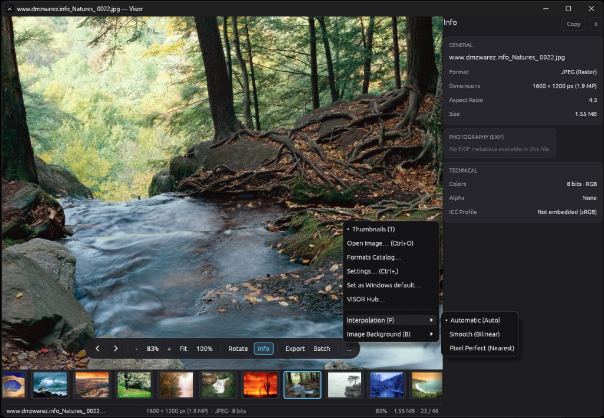

<div align="center">

<p align="center">
  
</p>

# VISOR

**Der ultraschnelle, moderne und 100% datenschutzfreundliche Bildbetrachter für Windows 10 & 11 in nativem Rust.**

<br>

### 🌐 Sprache wählen / Select Language / Selecione o Idioma / 选择语言:

[-009c3b?style=for-the-badge&logo=flag&logoColor=white)](README.md)
[](README.en.md)
[](README.es.md)
[](README.zh-CN.md)
[](README.ru.md)
[](README.de.md)
[](README.ja.md)
[](README.pl.md)
[](README.fr.md)
[](README.it.md)

<br>

<p align="center">
  <a href="https://github.com/Tsujiu/visor/releases/latest"></a>
  <a href="https://www.rust-lang.org/"></a>
  
  
  
</p>

<p align="center">
  <a href="#-download--installation"><strong>VISOR v1.0.0 herunterladen</strong></a>
  &nbsp;•&nbsp;
  <a href="#-warum-visor">Funktionen</a>
  &nbsp;•&nbsp;
  <a href="#-unterst%C3%BCtzte-formate-75">Formate</a>
  &nbsp;•&nbsp;
  <a href="#-tastenkombinationen">Tastenkürzel</a>
  &nbsp;•&nbsp;
  <a href="#-entwicklung-unterst%C3%BCtzen--buy-me-a-coffee"><strong>Projekt unterstützen ☕</strong></a>
</p>

</div>

---

## 🖼️ Screenshots

<p align="center">
  
</p>

<p align="center">
  <em>Flüssiges Fluent Design, anpassungsfähige Werkzeugleiste und asynchrone Filmleiste für Miniaturansichten.</em>
</p>

---

## ⚡ Warum VISOR?

Standard-Bildbetrachter in Windows sind oft träge, überladen und voller ständiger Telemetrie. **VISOR** wurde von Grund auf in **nativem Rust** mit GPU-Beschleunigung entwickelt:

* 🚀 **Blitzschneller Start:** Öffnet hochauflösende Dateien in Millisekunden ohne Einfrieren.
* 🛡️ **Absolute Privatsphäre:** Funktioniert **100% offline**. Keine Fotos, Miniaturansichten oder Metadaten verlassen Ihren Computer.
* 🍃 **Geringster Ressourcenverbrauch:** 20 bis 40 MB RAM-Bedarf und 0% CPU-Last im Leerlauf.
* 🎯 **100% (1:1) Zoom als Standard:** Zeigt jeden Pixel sofort nativ an, mit stufenlosem Zoom von 1% bis 6400% zentriert auf den Mauszeiger.
* 🔍 **Dynamischer Pixel-Perfect-Modus:** Knackig scharfe Nearest-Neighbor-Skalierung für Pixel-Art, Game-Texturen und Vektoren.
* 🎞️ **Miniatur-Filmleiste (Filmstrip):** Schnelles Durchblättern mit asynchronem Hintergrund-Laden.
* 📊 **Technisches EXIF- & ICC-Panel:** Detaillierte Analyse von Kameramodell, Objektiv, Blende, ISO, Belichtungszeit, ICC-Profil und GPS.
* 🔄 **Integrierte Stapelkonvertierung:** Konvertieren Sie Ordner in verschiedene Formate unter Beibehaltung von bis zu 16-Bit Farbtiefe.
* 🌐 **Oberfläche in 9 Sprachen:** Deutsch, Englisch, Spanisch, Portugiesisch, Französisch, Italienisch, Russisch, Chinesisch und Japanisch.

---

## 📸 Visuelle Demonstration

| Miniatur-Filmleiste (Filmstrip) | Technisches EXIF-Panel & Menüs |
| :---: | :---: |
|  |  |
| *Flüssige Navigation mit asynchronem Vorladen* | *Vollständige EXIF-Metadatenanalyse, Interpolationsmodi & Steuerung* |

---

## 📦 Unterstützte Formate (75+)

* **Foto & Raster:** PNG, APNG, JPEG, JFIF, WebP, AVIF, JPEG XL (JXL), TIFF (16-bit), BMP, DIB, QOI, HDR Radiance, OpenEXR (EXR), ICO, CUR, Adobe Photoshop (PSD, PSB), GIMP (XCF), OpenRaster (ORA), Farbfeld, JPEG 2000 (JP2, J2K), Netpbm, SGI, Sun RAS, WBMP, XBM.
* **Vektor, CAD & Design:** CorelDRAW (.cdr v3 bis 2024+ mit Vorschau-Extraktion), SVG & SVGZ, AutoCAD DXF, Windows EMF & WMF (GDI+), sowie PDF, EPS, PS, AI via ImageMagick im PATH.
* **Animationen:** GIF, APNG, Windows animierte Cursor (ANI), MNG, Lottie (.lottie, .json) und Telegram Sticker (.tgs).
* **Kamera-RAW:** Canon (CR2, CRW, CR3), Nikon (NEF, NRW), Sony (ARW, SRF, SR2), Fujifilm (RAF), Olympus (ORF), Panasonic (RW2), Pentax (PEF), Hasselblad (3FR), Phase One (IIQ, CAP), Epson (ERF), Kodak (KDC, DCR), Mamiya (MOS), Minolta (MRW), Sigma (X3F), Casio (BAY), Adobe DNG.
* **Spiele-Texturen:** DirectDraw Surface (DDS mit BC1 bis BC7 & Mipmaps), Khronos KTX 1/2, Valve VTF, Blizzard BLP, Half-Life Sprites (.spr), RenderWare TXD, ASTC, Basis Universal, PowerVR PVR, Klei KTEX.

---

## ⌨️ Tastenkombinationen

| Taste | Aktion |
| :--- | :--- |
| `Strg` + `O` | Bilddatei öffnen |
| `←` / `→` | Vorheriges / nächstes Bild im Ordner |
| `Pos1` / `Ende` | Erstes / letztes Bild im Ordner |
| `1` | 100% Zoom (Tatsächliche Größe 1:1) |
| `F` | Zwischen An Fenster anpassen und 1:1 umschalten |
| `P` | Interpolation umschalten (Pixel Perfect / Glätten / Auto) |
| `R` / `Umschalt` + `R` | Um 90° im / gegen den Uhrzeigersinn drehen |
| `+` / `−` | Vergrößern / Verkleinern |
| `Mausrad` | Zoom an Mauszeiger-Position (oder Bildwechsel) |
| `T` | Filmleiste ein- / ausblenden |
| `I` | EXIF-Metadatenpanel ein- / ausblenden |
| `B` | Hintergrund wechseln (Schachbrett dunkel/hell, Schwarz, Weiß, Eigene Farbe) |
| `Leertaste` | Animation abspielen / pausieren |
| `Strg` + `C` | Bild mit Transparenz in Zwischenablage kopieren |
| `Entf` | Bild sicher in den Windows-Papierkorb verschieben |
| `Strg` + `,` | Einstellungen öffnen |
| `F11` | Vollbildmodus umschalten |

---

## 📥 Download & Installation

### Option 1: Offizieller Installer (.exe) oder Portable (.zip) für Windows 10 & 11
Laden Sie die neueste Version unter [Releases](https://github.com/Tsujiu/visor/releases/latest) herunter.

### Option 2: Aus Quellcode kompilieren
```bash
git clone https://github.com/Tsujiu/visor.git
cd visor
cargo build --release
# Die Binärdatei befindet sich unter: target/release/visor.exe
```

---

## ☕ Entwicklung unterstützen / Buy Me a Coffee

**VISOR** ist ein unabhängiges, kostenloses Open-Source-Projekt ohne Werbung oder Tracking. Wenn Ihnen VISOR gefällt, können Sie die Weiterentwicklung freiwillig mit jedem Betrag unterstützen:

<p align="center">
  <a href="https://donate.stripe.com/test_eVq3cu6eK5tO5yb2yc3VC04"></a>
  &nbsp;&nbsp;
  <a href="https://linknabio.gg/mutsujii"></a>
</p>

* **🌍 Internationale Spenden (Stripe - Freier Betrag):** [Stripe Spenden-Link (\$1, \$5, \$10, \$20, \$50, \$100 oder Wunschbetrag)](https://donate.stripe.com/test_eVq3cu6eK5tO5yb2yc3VC04)

---

## 📄 Lizenz

Vertrieben unter freien Open-Source-Bedingungen. Siehe [LICENSE](LICENSE).

---

<p align="center">
  Entwickelt von <strong>Tsujiu</strong> • Mit ❤️ in Rust programmiert
</p>
