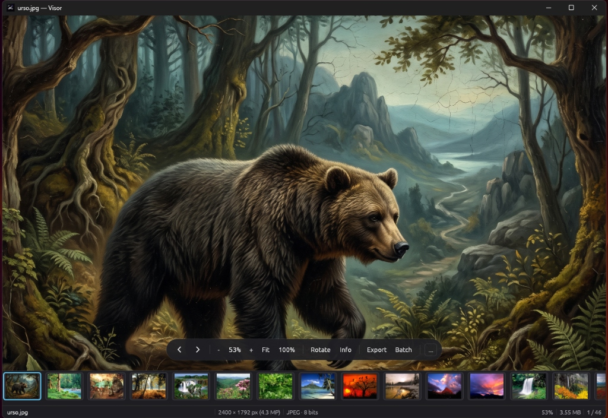
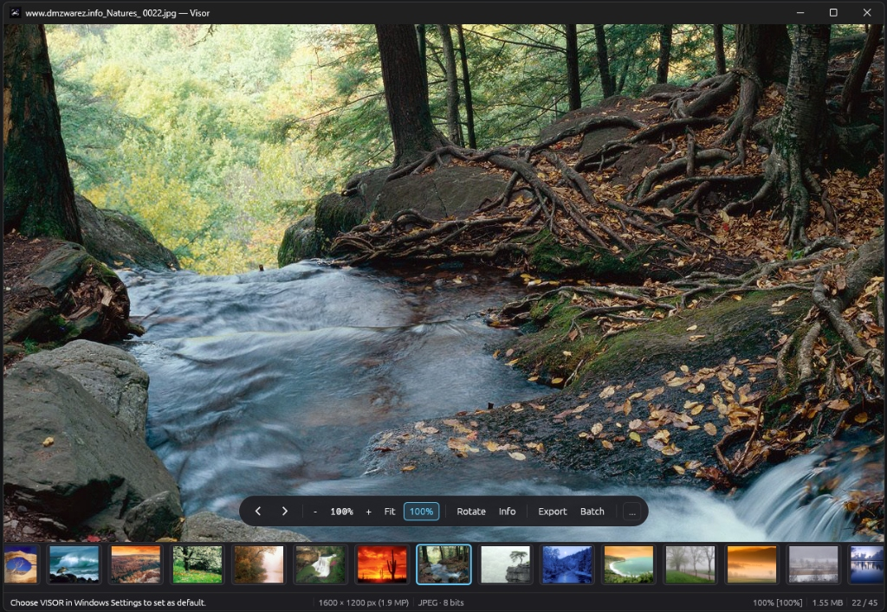
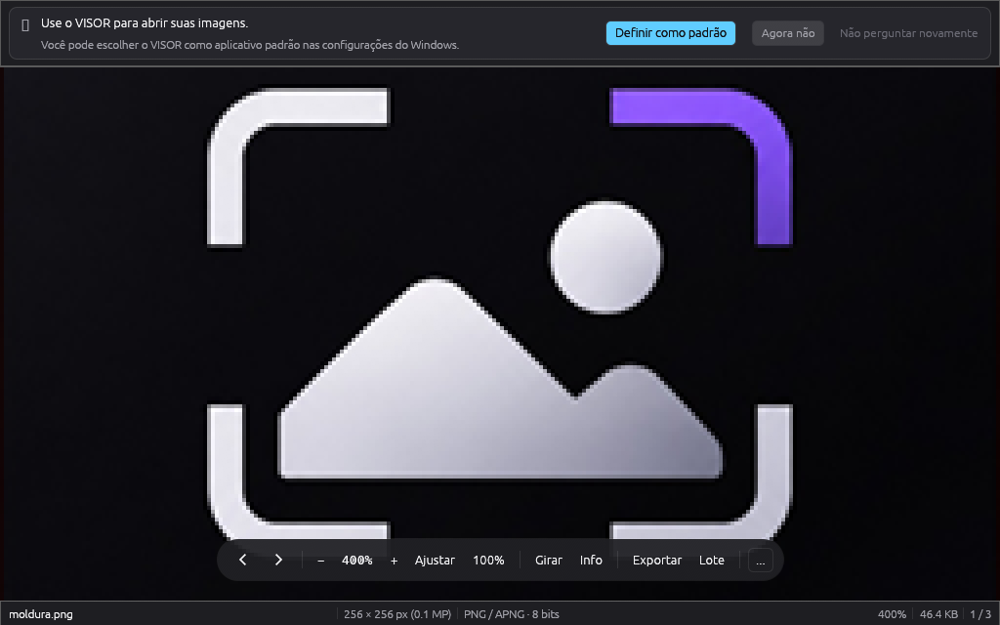

<div align="center">

<p align="center">
  
</p>

# VISOR

**El visor de imágenes ultrarrápido, moderno y 100% privado diseñado para Windows 10 y 11 en Rust.**

<br>

### 🌐 Seleccione el Idioma / Select Language / 选择语言 / Выберите язык:

[-009c3b?style=for-the-badge&logo=flag&logoColor=white)](README.md)
[](README.en.md)
[](README.es.md)
[](README.zh-CN.md)
[](README.ru.md)
[](README.de.md)
[](README.ja.md)
[](README.pl.md)
[](README.fr.md)
[](README.it.md)

<br>

<details>
<summary><b>🌍 Traducción Automática Instantánea de GitHub (Google Translate)</b></summary>

| Idioma / Language | Botón de Traducción Directa |
| :--- | :--- |
| 🇪🇸 **Español** | [⚡ Traducir Repositorio al Español](https://translate.google.com/translate?sl=auto&tl=es&u=https://github.com/Tsujiu/visor) |
| 🇺🇸 **English** | [⚡ Translate Repository to English](https://translate.google.com/translate?sl=auto&tl=en&u=https://github.com/Tsujiu/visor) |
| 🇧🇷 **Português (BR)** | [⚡ Traduzir Repositório para Português](https://translate.google.com/translate?sl=auto&tl=pt&u=https://github.com/Tsujiu/visor) |
| 🇨🇳 **简体中文** | [⚡ 在浏览器中将仓库自动翻译为简体中文](https://translate.google.com/translate?sl=auto&tl=zh-CN&u=https://github.com/Tsujiu/visor) |
| 🇷🇺 **Русский** | [⚡ Открыть репозиторий с переводом на русский](https://translate.google.com/translate?sl=auto&tl=ru&u=https://github.com/Tsujiu/visor) |
| 🇩🇪 **Deutsch** | [⚡ Repository automatisch auf Deutsch übersetzen](https://translate.google.com/translate?sl=auto&tl=de&u=https://github.com/Tsujiu/visor) |
| 🇯🇵 **日本語** | [⚡ リポジトリ全体を日本語に自動翻訳](https://translate.google.com/translate?sl=auto&tl=ja&u=https://github.com/Tsujiu/visor) |
| 🇵🇱 **Polski** | [⚡ Przetłumacz całe repozytorium na język polski](https://translate.google.com/translate?sl=auto&tl=pl&u=https://github.com/Tsujiu/visor) |
| 🇫🇷 **Français** | [⚡ Traduire automatiquement le dépôt en français](https://translate.google.com/translate?sl=auto&tl=fr&u=https://github.com/Tsujiu/visor) |
| 🇮🇹 **Italiano** | [⚡ Traduci automaticamente il repository in italiano](https://translate.google.com/translate?sl=auto&tl=it&u=https://github.com/Tsujiu/visor) |

</details>

<br>

<p align="center">
  <a href="https://github.com/Tsujiu/visor/releases/latest"></a>
  <a href="https://www.rust-lang.org/"></a>
  
  
  
</p>

<p align="center">
  <a href="#-descarga--instalaci%C3%B3n"><strong>Descargar VISOR v1.0.0</strong></a>
  &nbsp;•&nbsp;
  <a href="#-por-qu%C3%A9-visor">Características</a>
  &nbsp;•&nbsp;
  <a href="#-formatos-compatibles-75">Formatos</a>
  &nbsp;•&nbsp;
  <a href="#-atajos-de-teclado">Atajos</a>
  &nbsp;•&nbsp;
  <a href="#-apoye-el-desarrollo--buy-me-a-coffee"><strong>Apoyar el Proyecto ☕</strong></a>
</p>

</div>

---

## 🖼️ Capturas de Pantalla

<p align="center">
  
</p>

<p align="center">
  <em>Interfaz moderna con estilo Fluent Design, barra de herramientas adaptativa y tira inferior de miniaturas asíncrona.</em>
</p>

---

## ⚡ ¿Por qué VISOR?

Los visores de imágenes predeterminados de Windows se han vuelto lentos, pesados y saturados de telemetría constante. **VISOR** fue desarrollado desde cero en **Rust nativo** con aceleración por hardware GPU para ofrecer:

* 🚀 **Inicio Instantáneo:** Abre archivos de gran tamaño en milisegundos sin congelar la pantalla.
* 🛡️ **Privacidad Absoluta:** Opera **100% sin conexión (offline)**. Ninguna imagen, miniatura o metadato sale de su computadora.
* 🍃 **Consumo Prácticamente Nulo en Reposo:** 20 a 40 MB de memoria RAM y 0% de uso de CPU inactivo.
* 🎯 **Zoom Predeterminado al 100% (1:1):** Muestra cada píxel en su resolución nativa de inmediato, con zoom suave continuo de 1% a 6400% anclado al cursor.
* 🔍 **Modo Pixel-Perfect Dinámico:** Muestreo Nearest Neighbor ultra nítido sin desenfoque para pixel art y texturas de videojuegos.
* 🎞️ **Tira de Miniaturas (Filmstrip):** Navegación ágil en la parte inferior con precarga asíncrona en segundo plano.
* 📊 **Panel Técnico EXIF e ICC:** Inspección profunda de parámetros fotográficos (Cámara, Lente, Apertura f-stop, ISO, Obturador, perfil de color ICC y coordenadas GPS).
* 🔄 **Conversor por Lotes Integrado:** Convierta carpetas completas a múltiples formatos manteniendo hasta 16 bits de profundidad.
* 🌐 **Interfaz en 9 Idiomas:** Español, Inglés, Portugués, Francés, Alemán, Italiano, Ruso, Chino Simplificado y Japonés.

---

## 📸 Demostración Visual

| Tira de Miniaturas (Filmstrip) | Inspección Pixel Perfect & Texturas |
| :---: | :---: |
|  |  |
| *Navegación fluida desacoplada con precarga asíncrona* | *Nitidez máxima 1:1 sin desenfoque de interpolación* |

---

## 📊 Comparativa

| Función | VISOR | Fotos de Windows | IrfanView | ImageGlass |
| :--- | :---: | :---: | :---: | :---: |
| **Lenguaje Principal** | **Rust Nativo** | C# / WinUI | C++ | C# / .NET |
| **Tiempo de Apertura** | **< 30 ms** | ~1.5 s - 3 s | ~100 ms | ~800 ms |
| **Telemetría y Rastreo** | **Cero (100% Offline)** | Constante | Ninguno | Parcial |
| **Formatos Modernos (AVIF, JXL, WebP)** | **Sí (Nativo)** | Limitado | Vía Plugins | Sí |
| **Formatos RAW Profesionales (23+ marcas)** | **Sí (Nativo)** | Requiere Extensión | Vía Plugin C | Parcial |
| **Texturas de Videojuegos (DDS, KTX2, VTF)** | **Sí (Nativo)** | No | No | No |
| **Estética Fluent Windows 11** | **Nativa y Moderna** | Nativa | Años 90 | Moderna |

---

## 📦 Formatos Compatibles (75+)

* **Fotografía y Raster:** PNG, APNG, JPEG, JFIF, WebP, AVIF, JPEG XL (JXL), TIFF (16-bit), BMP, DIB, QOI, HDR Radiance, OpenEXR (EXR), ICO, CUR, Adobe Photoshop (PSD, PSB capas acopladas), GIMP (XCF), OpenRaster (ORA), Farbfeld (16-bit), JPEG 2000 (JP2, J2K), Netpbm (PPM, PGM, PBM, PAM), SGI, Sun RAS, WBMP, XBM.
* **Vectorial, CAD e Ilustración:** CorelDRAW (.cdr v3 a 2024+ con extracción de vista previa en alta resolución), SVG y SVGZ seguro, AutoCAD DXF, Windows EMF y WMF (vía GDI+), PDF, EPS, PS y Adobe Illustrator (AI) vía ImageMagick en PATH.
* **Animaciones Nativas:** GIF, APNG, Cursor Animado de Windows (ANI), MNG, Animaciones Vectoriales Lottie (.lottie, .json) y Stickers Animados de Telegram (.tgs).
* **Fotografía RAW de Cámaras:** Canon (CR2, CRW, CR3), Nikon (NEF, NRW), Sony (ARW, SRF, SR2), Fujifilm (RAF), Olympus (ORF), Panasonic (RW2), Pentax (PEF), Hasselblad (3FR), Phase One (IIQ, CAP), Epson (ERF), Kodak (KDC, DCR), Mamiya (MOS), Minolta (MRW), Sigma (X3F), Casio (BAY) y Adobe DNG.
* **Texturas de Videojuegos y Motores:** DirectDraw Surface (DDS BC1 a BC7 y Mipmaps), Khronos KTX 1 y KTX 2, Valve Texture Format (VTF), Blizzard BLP1/BLP2, GoldSrc Sprites (.spr), RenderWare TXD (GTA III / VC / SA), ASTC, Basis Universal, PowerVR PVR y Klei KTEX.

---

## ⌨️ Atajos de Teclado

| Tecla | Acción |
| :--- | :--- |
| `Ctrl` + `O` | Abrir imagen |
| `←` / `→` | Imagen anterior / siguiente en la carpeta |
| `Home` / `End` | Primera / última imagen de la carpeta |
| `1` | Zoom 100% (Tamaño Real 1:1) |
| `F` | Alternar entre Ajustar a Ventana y Tamaño Real |
| `P` | Alternar modo de interpolación (Pixel Perfect / Suave / Auto) |
| `R` / `Shift` + `R` | Girar imagen 90° a la derecha / izquierda |
| `+` / `−` | Zoom in / Zoom out |
| `Rueda del Ratón` | Zoom centrado en el cursor (o navegación) |
| `T` | Mostrar / ocultar tira inferior de miniaturas (Filmstrip) |
| `I` | Mostrar / ocultar panel técnico EXIF |
| `B` | Alternar fondo del lienzo (Ajedrez oscuro/claro, negro, blanco, personalizado) |
| `Espacio` | Reproducir / pausar animaciones |
| `Ctrl` + `C` | Copiar imagen al Portapapeles con canal alfa transparente |
| `Delete` | Enviar imagen a la Papelera de reciclaje de Windows |
| `Ctrl` + `,` | Abrir Configuración |
| `F11` | Pantalla Completa |

---

## 📥 Descarga e Instalación

### Opción 1: Instalador Oficial (.exe) o Versión Portable (.zip) para Windows 10 y 11
Descargue la última versión en [Releases](https://github.com/Tsujiu/visor/releases/latest) (instalador Inno Setup o archivo portátil sin instalación).

### Opción 2: Compilar desde el Código Fuente
Asegúrese de tener **Rust** instalado:
```bash
# Clonar repositorio
git clone https://github.com/Tsujiu/visor.git
cd visor

# Compilar en modo release optimizado
cargo build --release

# El ejecutable se encontrará en:
target/release/visor.exe
```

---

## ☕ Apoye el Desarrollo / Buy Me a Coffee

**VISOR** es un proyecto de código abierto independiente, 100% gratuito y sin publicidad ni recolección de datos personales. Si VISOR le resulta útil en su día a día, puede apoyar voluntariamente con cualquier importe:

<p align="center">
  <a href="https://donate.stripe.com/test_eVq3cu6eK5tO5yb2yc3VC04"></a>
  &nbsp;&nbsp;
  <a href="https://linknabio.gg/mutsujii"></a>
  &nbsp;&nbsp;
  <a href="https://donate.stripe.com/test_5kQ4gydHc5tO6Cf5Ko3VC05"></a>
</p>

* **🌍 Donantes Internacionales (Stripe - Importe Libre):** [Donar vía Stripe (Elija \$1, \$5, \$10, \$20, \$50, \$100 o personalizado)](https://donate.stripe.com/test_eVq3cu6eK5tO5yb2yc3VC04)
* **🇧🇷 Donaciones en Brasil (PIX / InfinitePay):** [https://linknabio.gg/mutsujii](https://linknabio.gg/mutsujii)
* **🇧🇷 Tarjeta de Crédito (Stripe Brasil):** [Donar vía Stripe (Elija R\$ 5, R\$ 15, R\$ 50 o personalizado)](https://donate.stripe.com/test_5kQ4gydHc5tO6Cf5Ko3VC05)

---

## 📄 Licencia

Distribuido bajo términos de software libre y de código abierto para uso personal y profesional. Consulte el archivo [LICENSE](LICENSE).

---

<p align="center">
  Desarrollado con dedicación por <strong>Tsujiu</strong> • Hecho con ❤️ en Rust
</p>
