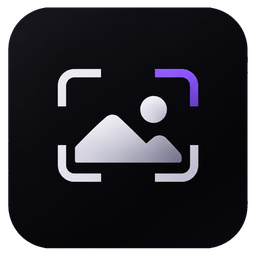

<p align="center">
  
</p>

<h1 align="center">Visor</h1>

<p align="center">
  Visualizador de imagens para Windows.<br>
  Abre o arquivo, mostra na hora e fica na sua máquina.
</p>

<p align="center">
  <a href="https://github.com/Tsujiu/visor/releases/latest/download/Visor-Setup-0.2.0.exe"><strong>Baixar o instalador</strong></a>
  &nbsp;·&nbsp;
  <a href="https://github.com/Tsujiu/visor/releases/latest">Outras versões</a>
</p>

O Visor não tem conta, telemetria, anúncio, atualização em segundo plano nem envio de imagens. A decodificação é local. Metadados EXIF aparecem na tela e não saem do computador. Nada no programa abre uma conexão de rede.

A única escrita fora da pasta de instalação é a associação de arquivos, e só neste usuário: na primeira abertura, se o Visor ainda não for o programa do PNG, ou quando você marca essa opção no instalador, ou pelo botão **Padrão**. O registro fica no Windows. Se o sistema recusar, ele abre a tela de aplicativos padrão para você escolher.

## Instalar

O instalador é para o usuário atual, em `%LOCALAPPDATA%\Programs\Visor`, sem administrador. Ele cria o atalho no Menu Iniciar. Área de trabalho e programa padrão são opcionais. A remoção fica em Configurações, em Aplicativos instalados.

O arquivo não tem assinatura digital. O Windows pode pedir confirmação antes de executar.

## Uso

Arraste uma imagem ou use **Abrir**. A leitura acontece fora da interface. A roda amplia a partir do cursor, o arrasto move, o duplo clique alterna entre ajustar e o tamanho real.

| Tecla | Ação |
| --- | --- |
| `Ctrl` `O` | Abrir |
| `←` `→` | Anterior e próxima da pasta |
| `Home` `End` | Primeira e última |
| `F` | Ajustar à janela |
| `1` | Um pixel da imagem por pixel da tela |
| `R` / `Shift` `R` | Girar |
| `+` `−` | Zoom |
| `I` | Informações técnicas, EXIF e perfil ICC |
| `Espaço` | Reproduzir ou pausar a animação |
| `Ctrl` `S` | Exportar |
| `F11` | Tela cheia |
| `Esc` | Sair da tela cheia |

**Lote** converte vários arquivos. **Formatos** lista o que cada extensão realmente faz. A exportação relê o arquivo original: PNG e TIFF de 16 bits continuam em 16 bits. A tela reduz o lado maior a 8192 px.

Os botões laterais do mouse também trocam de imagem.

## Formatos

Uma extensão só entra como suportada quando um teste abre um arquivo de verdade. O programa reconhece o conteúdo, não só o nome.

| Nível | Formatos |
| --- | --- |
| Completo | PNG, APNG, JPG, JPEG, JPE, JFIF, GIF, BMP, TIF, TIFF, ICO, TGA, QOI, HDR, PIC, PPM, PGM, PBM, PNM |
| Somente leitura | DIB, JXL, CUR, PCX, EXR, SGI, RGB, RGBA, BW, WBMP, KTX, KTX2, SVG, SVGZ, EMF |
| Parcial | WebP, RAS, DDS, WAL e RAW de câmera (DNG, CR2, NEF, ARW e outros do mesmo grupo) |
| ImageMagick no PATH | PDF, EPS, PS, AI, JP2, J2K e CDR. Sem o `magick`, esses arquivos não abrem |
| Não abre | AVIF, CR3, WMF, DXF, MNG, Lottie, TGS e texturas proprietárias como VTF, BLP, SPR, TXD, TEX, ASTC, BASIS, PVR e ATF |

Alfa é preservado quando o formato tem. GIF e APNG mantêm ordem e duração. SVG animado vira um quadro estático, sem executar script. RAW é uma prévia, sem demosaic. DDS mostra o primeiro mip; a cor foi conferida em RGBA e BC1.

Exportação: PNG, JPEG (qualidade 95), WebP sem perda, BMP, TIFF, GIF, QOI, TGA, ICO até 256 px, PNM e HDR.

## Compilar

Rust 1.95 ou mais recente, no Windows, com `windres` do MinGW no `PATH` para o ícone do executável.

```text
cargo build --release
```

O instalador é o script `installer/visor.iss`, compilado com Inno Setup 6. O resultado sai em `dist/`.

O registro de tipos de arquivo usa `third_party/SFTA.ps1`, sob a licença MIT indicada no próprio arquivo.
