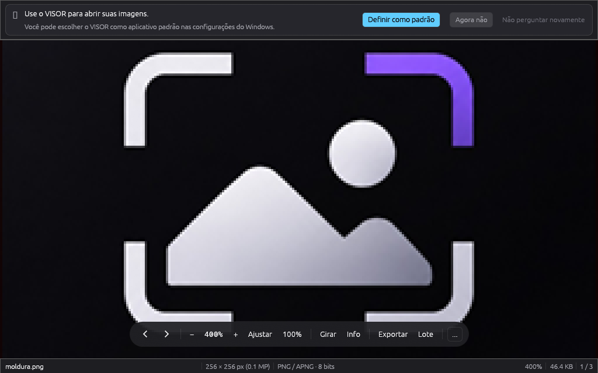

<div align="center">

<p align="center">
  
</p>

# VISOR

**O visualizador de imagens ultrarrápido, moderno e 100% privativo para Windows 10 e 11.**<br>
*The ultra-fast, modern, and privacy-first image viewer engineered for Windows 10 & 11.*

<br>

### 🌐 Selecione o Idioma / Select Language / 选择语言 / Выберите язык:

[-009c3b?style=for-the-badge&logo=flag&logoColor=white)](README.md)
[](README.en.md)
[](README.es.md)
[](README.zh-CN.md)
[](README.ru.md)
[](README.de.md)
[](README.ja.md)
[](README.pl.md)
[](README.fr.md)
[](README.it.md)

<br>

<details>
<summary><b>🌍 Traduzir Todo o GitHub Automaticamente (Google Translate) / Auto-Translate GitHub</b></summary>

| Idioma / Language | Botão de Tradução Direta no Navegador |
| :--- | :--- |
| 🇧🇷 **Português (BR)** | [⚡ Traduzir Repositório para Português](https://translate.google.com/translate?sl=auto&tl=pt&u=https://github.com/Tsujiu/visor) |
| 🇺🇸 **English** | [⚡ Translate Repository to English](https://translate.google.com/translate?sl=auto&tl=en&u=https://github.com/Tsujiu/visor) |
| 🇪🇸 **Español** | [⚡ Traducir Repositorio al Español](https://translate.google.com/translate?sl=auto&tl=es&u=https://github.com/Tsujiu/visor) |
| 🇨🇳 **简体中文** | [⚡ 在浏览器中将仓库自动翻译为简体中文](https://translate.google.com/translate?sl=auto&tl=zh-CN&u=https://github.com/Tsujiu/visor) |
| 🇷🇺 **Русский** | [⚡ Открыть репозиторий с переводом на русский](https://translate.google.com/translate?sl=auto&tl=ru&u=https://github.com/Tsujiu/visor) |
| 🇩🇪 **Deutsch** | [⚡ Repository automatisch auf Deutsch übersetzen](https://translate.google.com/translate?sl=auto&tl=de&u=https://github.com/Tsujiu/visor) |
| 🇯🇵 **日本語** | [⚡ リポジトリ全体を日本語に自動翻訳](https://translate.google.com/translate?sl=auto&tl=ja&u=https://github.com/Tsujiu/visor) |
| 🇵🇱 **Polski** | [⚡ Przetłumacz całe repozytorium na język polski](https://translate.google.com/translate?sl=auto&tl=pl&u=https://github.com/Tsujiu/visor) |
| 🇫🇷 **Français** | [⚡ Traduire automatiquement le dépôt en français](https://translate.google.com/translate?sl=auto&tl=fr&u=https://github.com/Tsujiu/visor) |
| 🇮🇹 **Italiano** | [⚡ Traduci automaticamente il repository in italiano](https://translate.google.com/translate?sl=auto&tl=it&u=https://github.com/Tsujiu/visor) |

</details>

<br>

<p align="center">
  <a href="https://github.com/Tsujiu/visor/releases/latest"></a>
  <a href="https://www.rust-lang.org/"></a>
  
  
  
</p>

<p align="center">
  <a href="#-download--instalação"><strong>Baixar VISOR v1.0.0</strong></a>
  &nbsp;•&nbsp;
  <a href="#-recursos-principais">Recursos</a>
  &nbsp;•&nbsp;
  <a href="#-formatos-suportados-75">Formatos</a>
  &nbsp;•&nbsp;
  <a href="#-atalhos-de-teclado">Atalhos</a>
  &nbsp;•&nbsp;
  <a href="#-apoie-o-desenvolvimento--buy-me-a-coffee"><strong>Apoiar o Projeto ☕</strong></a>
</p>

</div>

---

## 🖼️ Capturas de Tela / Screenshots

<p align="center">
  
</p>

<p align="center">
  <em>Interface fluida no estilo Fluent Design, barra de ferramentas adaptável e tira de miniaturas inferior de alta fidelidade.</em>
</p>

---

## ⚡ Por que o VISOR?

Os visualizadores de imagem padrão do Windows tornaram-se lentos, pesados e cheios de recursos desnecessários e telemetria constante. O **VISOR** foi construído do zero em **Rust** com aceleração por hardware GPU para entregar:

* 🚀 **Inicialização Instantânea:** Abre arquivos pesados em milissegundos sem congelar a tela.
* 🛡️ **Privacidade Absoluta:** Opera **100% offline**. Nenhuma foto, miniatura, metadado ou histórico de navegação jamais sai do seu computador.
* 🍃 **Zero Consumo em Repouso:** 20 a 40 MB de memória RAM e 0% de uso de CPU quando inativo.
* 🎯 **Zoom Padrão em 100% (1:1):** Exibe cada pixel na resolução nativa imediatamente, com zoom contínuo suave de 1% a 6400% ancorado no cursor.
* 🔍 **Modo Pixel-Perfect Dinâmico:** Nearest Neighbor nítido sem borrões para pixel art, inspeção de texturas de jogos e gráficos vetoriais.
* 🎞️ **Tira de Miniaturas (Filmstrip):** Navegação ágil na base da tela com pré-carregamento assíncrono em segundo plano.
* 📊 **Painel Técnico EXIF & ICC:** Inspeção profunda de parâmetros fotográficos (Câmera, Lente, Abertura f-stop, ISO, Obturador, perfil de cor ICC e coordenadas GPS).
* 🔄 **Conversor em Lote Integrado (Batch Export):** Converta diretórios inteiros para múltiplos formatos preservando até 16 bits de profundidade.
* 🌐 **Interface em 9 Idiomas:** Português do Brasil, Inglês, Espanhol, Francês, Alemão, Italiano, Russo, Chinês Simplificado e Japonês.

---

## 📸 Demonstração Visual

| Tira de Miniaturas (Filmstrip) | Inspeção Pixel Perfect & Texturas |
| :---: | :---: |
|  |  |
| *Navegação suave desacoplada com carregamento assíncrono* | *Nitidez máxima 1:1 sem interpolação borrada* |

---

## 📊 Comparativo

| Recurso | VISOR | Windows Fotos | IrfanView | ImageGlass |
| :--- | :---: | :---: | :---: | :---: |
| **Linguagem Principal** | **Rust Nativo** | C# / WinUI | C++ | C# / .NET |
| **Tempo de Abertura** | **< 30 ms** | ~1.5 s - 3 s | ~100 ms | ~800 ms |
| **Telemetria e Coleta de Dados** | **Zero (100% Offline)** | Constante | Nenhuma | Parcial |
| **Formatos Modernos (AVIF, JXL, WebP)** | **Sim (Nativo)** | Limitado | Via Plugins | Sim |
| **Formatos RAW Profissionais (23+ marcas)** | **Sim (Nativo)** | Requer Extensão | Via Plugin C | Parcial |
| **Texturas de Jogos (DDS, KTX2, VTF)** | **Sim (Nativo)** | Não | Não | Não |
| **Estética Fluent Windows 11** | **Nativa & Moderna** | Nativa | Anos 90 | Moderna |

---

## 📦 Formatos Suportados (75+)

O VISOR possui um dos mais abrangentes motores de decodificação de imagem:

* **Fotografia & Raster de Alta Precisão:** PNG, APNG, JPEG, JFIF, WebP, AVIF, JPEG XL (JXL), TIFF (16-bit), BMP, DIB, QOI, HDR Radiance, OpenEXR (EXR), ICO, CUR, Adobe Photoshop (PSD, PSB composições achatadas), GIMP (XCF camadas visíveis), OpenRaster (ORA), Farbfeld (16-bit), JPEG 2000 (JP2, J2K), Netpbm (PPM, PGM, PBM, PAM), SGI, Sun RAS, WBMP, XBM.
* **Vetoriais, CAD & Ilustração:** CorelDRAW (.cdr v3 a 2024+ com extração de preview em alta resolução), SVG & SVGZ nativo e seguro, AutoCAD DXF, Windows EMF & WMF (via GDI+), e PDF, EPS, PS, Adobe Illustrator (AI) via ImageMagick no PATH.
* **Animações Nativas:** GIF, APNG, Cursor Animado do Windows (ANI), MNG, Animações Vetoriais Lottie (.lottie, .json) e Telegram Animated Stickers (.tgs).
* **Fotografias RAW de Câmeras Profissionais:** Canon (CR2, CRW, CR3), Nikon (NEF, NRW), Sony (ARW, SRF, SR2), Fujifilm (RAF), Olympus (ORF), Panasonic (RW2), Pentax (PEF), Hasselblad (3FR), Phase One (IIQ, CAP), Epson (ERF), Kodak (KDC, DCR), Mamiya (MOS), Minolta (MRW), Sigma (X3F), Casio (BAY) e Adobe DNG.
* **Texturas de Games & Engines:** DirectDraw Surface (DDS com suporte a BC1 a BC7 e Mipmaps), Khronos KTX 1 e KTX 2, Valve Texture Format (VTF), Blizzard BLP1/BLP2, GoldSrc / Half-Life Sprites (.spr), RenderWare TXD (GTA III / VC / SA), ASTC, Basis Universal, PowerVR PVR e Klei KTEX.

---

## ⌨️ Atalhos de Teclado

| Tecla | Ação |
| :--- | :--- |
| `Ctrl` + `O` | Abrir imagem |
| `←` / `→` | Imagem anterior / próxima na pasta |
| `Home` / `End` | Primeira / última imagem da pasta |
| `1` | Zoom 100% (Tamanho Real 1:1) |
| `F` | Alternar entre Ajustar à Janela e Tamanho Real |
| `P` | Alternar modo de interpolação (Pixel Perfect / Suave / Auto) |
| `R` / `Shift` + `R` | Girar imagem 90° à direita / esquerda |
| `+` / `−` | Zoom in / Zoom out |
| `Roda do Mouse` | Zoom no cursor (ou navegação, personalizável em Configurações) |
| `T` | Exibir / ocultar tira inferior de miniaturas (Filmstrip) |
| `I` | Exibir / ocultar painel lateral técnico EXIF |
| `B` | Alternar cor de fundo (Xadrez escuro/claro, preto, branco, personalizado) |
| `Espaço` | Reproduzir / pausar animações (GIF, APNG, Lottie) |
| `Ctrl` + `C` | Copiar imagem para a Área de Transferência com transparência |
| `Delete` | Enviar imagem com segurança para a Lixeira do Windows |
| `Ctrl` + `,` | Abrir tela de Configurações |
| `F11` | Alternar Modo Tela Cheia |

---

## 📥 Download & Instalação

### Opção 1: Instalador Oficial (.exe) ou Versão Portátil (.zip) para Windows 10 e 11
Baixe a versão mais recente em [Releases](https://github.com/Tsujiu/visor/releases/latest) (instalador executável Inno Setup ou arquivo compactado portátil pronto para uso).

### Opção 2: Compilar a partir do Código-Fonte
Certifique-se de ter o compilador **Rust** instalado:
```bash
# Clone o repositório
git clone https://github.com/Tsujiu/visor.git
cd visor

# Compile em modo release otimizado
cargo build --release

# O executável estará em:
target/release/visor.exe
```

---

## ☕ Apoie o Desenvolvimento / Buy Me a Coffee

O **VISOR** é um projeto independente, gratuito e focado em privacidade, velocidade e ausência total de anúncios ou telemetria. Se o aplicativo é útil para o seu dia a dia, você pode apoiar o desenvolvimento contínuo com qualquer valor:

<p align="center">
  <a href="https://linknabio.gg/mutsujii"></a>
  &nbsp;&nbsp;
  <a href="https://donate.stripe.com/test_eVq3cu6eK5tO5yb2yc3VC04"></a>
  &nbsp;&nbsp;
  <a href="https://donate.stripe.com/test_5kQ4gydHc5tO6Cf5Ko3VC05"></a>
</p>

* **🇧🇷 Doações no Brasil (PIX / InfinitePay):** [https://linknabio.gg/mutsujii](https://linknabio.gg/mutsujii)
* **🌍 International Donors (Stripe - Choose any amount):** [Donate via Stripe (Choose \$1, \$5, \$10, \$20, \$50, \$100 or custom)](https://donate.stripe.com/test_eVq3cu6eK5tO5yb2yc3VC04)
* **🇧🇷 Doações via Cartão (Stripe Brasil - Escolha o valor):** [Doar via Stripe (Escolha R\$ 5, R\$ 15, R\$ 50 ou qualquer valor)](https://donate.stripe.com/test_5kQ4gydHc5tO6Cf5Ko3VC05)

Seu apoio ajuda a manter o projeto atualizado com novos formatos de câmeras, otimizações contínuas de GPU e 100% livre de telemetria.

---

## 📄 Licença

Distribuído sob a licença de software livre e uso pessoal. Consulte o arquivo [LICENSE](LICENSE) para mais detalhes.

---

<p align="center">
  Desenvolvido com dedicação por <strong>Tsujiu</strong> • Feito com ❤️ em Rust
</p>
