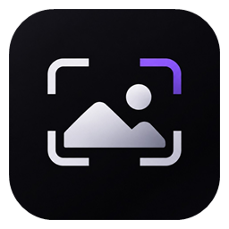

<div align="center">

<p align="center">
  
</p>

# VISOR

**Сверхбыстрый, современный и на 100% конфиденциальный просмотрщик изображений для Windows 10 и 11 на чистом Rust.**

<br>

### 🌐 Выберите язык / Select Language / Selecione o Idioma / 选择语言:

[-009c3b?style=for-the-badge&logo=flag&logoColor=white)](README.md)
[](README.en.md)
[](README.es.md)
[](README.zh-CN.md)
[](README.ru.md)
[](README.de.md)
[](README.ja.md)
[](README.pl.md)
[](README.fr.md)
[](README.it.md)

<br>

<p align="center">
  <a href="https://github.com/Tsujiu/visor/releases/latest"></a>
  <a href="https://github.com/Tsujiu/visor/actions/workflows/release-distribution.yml"></a>
  
  <a href="LICENSE"></a>
  <br>
  <a href="https://www.rust-lang.org/"></a>
  
  
  
</p>

<p align="center">
  <a href="#-скачать-и-установка"><strong>Скачать VISOR v1.0.1</strong></a>
  &nbsp;•&nbsp;
  <a href="#-почему-visor">Возможности</a>
  &nbsp;•&nbsp;
  <a href="#-поддерживаемые-форматы-75">Форматы</a>
  &nbsp;•&nbsp;
  <a href="#-горячие-клавиши">Клавиши</a>
  &nbsp;•&nbsp;
  <a href="#-поддержать-разработку--buy-me-a-coffee"><strong>Поддержать ☕</strong></a>
</p>

</div>

---

## 🖼️ Скриншоты

<p align="center">
  
</p>

<p align="center">
  <em>Плавный интерфейс в стиле Fluent Design Windows 11, адаптивная панель инструментов и асинхронная нижняя лента миниатюр.</em>
</p>

---

## ⚡ Почему VISOR?

Стандартный просмотрщик фотографий Windows стал медленным, перегруженным и полным ненужной телеметрии. **VISOR** создан с нуля на **чистом нативном Rust** с аппаратным ускорением GPU:

* 🚀 **Мгновенный запуск:** Открывает многомегабайтные файлы за миллисекунды без зависаний.
* 🛡️ **Абсолютная конфиденциальность:** Работает **на 100% офлайн**. Никакие изображения, миниатюры или метаданные никогда не покидают ваш компьютер.
* 🍃 **Минимальное потребление памяти:** Всего 20–40 МБ ОЗУ и 0% нагрузки на процессор в режиме ожидания.
* 🎯 **Масштаб 100% (1:1) по умолчанию:** Мгновенный показ пиксель-в-пиксель, плавное непрерывное масштабирование от 1% до 6400% с привязкой к курсору.
* 🔍 **Режим Pixel-Perfect:** Четкая интерполяция Nearest Neighbor без размытия для пиксель-арта, текстур игр и спрайтов.
* 🎞️ **Лента миниатюр (Filmstrip):** Быстрая навигация по папке с асинхронной фоновой подгрузкой.
* 📊 **Техническая панель EXIF и ICC:** Подробный анализ параметров съемки (Камера, объектив, диафрагма, ISO, выдержка, профиль ICC и координаты GPS).
* 🔄 **Пакетный конвертер:** Конвертация целых папок в различные форматы с сохранением глубины цвета до 16 бит.
* 🌐 **Интерфейс на 9 языках:** Русский, Английский, Португальский, Испанский, Немецкий, Французский, Итальянский, Китайский и Японский.

---

## 📸 Визуальная демонстрация

| Лента миниатюр (Filmstrip) | Техническая панель EXIF и меню |
| :---: | :---: |
|  |  |
| *Плавная навигация с асинхронной подгрузкой* | *Полная инспекция метаданных EXIF, режимов интерполяции и настроек* |

---

## 📊 Сравнение

| Параметр | VISOR | Фотографии Windows | IrfanView | ImageGlass |
| :--- | :---: | :---: | :---: | :---: |
| **Основной язык** | **Нативный Rust** | C# / WinUI | C++ | C# / .NET |
| **Время открытия** | **< 30 мс** | ~1.5 с - 3 с | ~100 мс | ~800 мс |
| **Сбор данных и телеметрия** | **Ноль (100% Офлайн)** | Постоянно | Нет | Частично |
| **Современные форматы (AVIF, JXL, WebP)** | **Да (Нативно)** | Ограничено | Через плагины | Да |
| **Профессиональный RAW (23+ марки)** | **Да (Нативно)** | Требует кодеки | Через плагин C | Частично |
| **Текстуры игр (DDS, KTX2, VTF)** | **Да (Нативно)** | Нет | Нет | Нет |
| **Дизайн Windows 11 Fluent** | **Нативный** | Нативный | Стиль 90-х | Современный |

---

## 📦 Поддерживаемые форматы (75+)

* **Фотография и растр высокой точности:** PNG, APNG, JPEG, JFIF, WebP, AVIF, JPEG XL (JXL), TIFF (16 бит), BMP, DIB, QOI, HDR Radiance, OpenEXR (EXR), ICO, CUR, Adobe Photoshop (PSD, PSB сведение), GIMP (XCF), OpenRaster (ORA), Farbfeld, JPEG 2000 (JP2, J2K), Netpbm (PPM, PGM, PBM, PAM), SGI, Sun RAS, WBMP, XBM.
* **Векторная графика и CAD:** CorelDRAW (.cdr v3–2024+ с извлечением превью высокого разрешения), SVG и SVGZ, AutoCAD DXF, Windows EMF и WMF (через GDI+), а также PDF, EPS, PS, AI при наличии ImageMagick в PATH.
* **Анимации:** GIF, APNG, анимированные курсоры Windows (ANI), MNG, векторные анимации Lottie (.lottie, .json) и стикеры Telegram (.tgs).
* **RAW негативы камер:** Canon (CR2, CRW, CR3), Nikon (NEF, NRW), Sony (ARW, SRF, SR2), Fujifilm (RAF), Olympus (ORF), Panasonic (RW2), Pentax (PEF), Hasselblad (3FR), Phase One (IIQ, CAP), Epson (ERF), Kodak (KDC, DCR), Mamiya (MOS), Minolta (MRW), Sigma (X3F), Casio (BAY), Adobe DNG.
* **Текстуры видеоигр:** DirectDraw Surface (DDS с BC1–BC7 и Mipmaps), Khronos KTX 1 и 2, Valve VTF, Blizzard BLP, Half-Life Sprites (.spr), RenderWare TXD (GTA III / VC / SA), ASTC, Basis Universal, PowerVR PVR, Klei KTEX.

---

## ⌨️ Горячие клавиши

| Клавиша | Действие |
| :--- | :--- |
| `Ctrl` + `O` | Открыть файл изображения |
| `←` / `→` | Предыдущее / следующее изображение |
| `Home` / `End` | Первое / последнее изображение в папке |
| `1` | Масштаб 100% (Реальный размер 1:1) |
| `F` | Переключение между подгонкой по окну и 1:1 |
| `P` | Переключение сглаживания (Pixel Perfect / Сглаживание / Авто) |
| `R` / `Shift` + `R` | Поворот на 90° по / против часовой стрелки |
| `+` / `−` | Увеличение / уменьшение масштаба |
| `Колесо мыши` | Масштабирование под курсором (или навигация) |
| `T` | Показать / скрыть ленту миниатюр |
| `I` | Показать / скрыть панель EXIF |
| `B` | Смена фона (Темная/светлая сетка, черный, белый, свой цвет) |
| `Пробел` | Воспроизведение / пауза анимации |
| `Ctrl` + `C` | Копировать в буфер обмена с прозрачностью |
| `Delete` | Безопасное удаление в Корзину Windows |
| `Ctrl` + `,` | Открыть настройки |
| `F11` | Полноэкранный режим |

---

## 📥 Скачать и установка

### Вариант 1: Официальный инсталлятор (.exe) или портативная версия (.zip)
Загрузите последнюю версию в разделе [Releases](https://github.com/Tsujiu/visor/releases/latest).

### Вариант 2: Сборка из исходного кода
Убедитесь, что у вас установлен компилятор **Rust**:
```bash
git clone https://github.com/Tsujiu/visor.git
cd visor
cargo build --release
# Исполняемый файл: target/release/visor.exe
```

---

## ☕ Поддержать разработку / Buy Me a Coffee

**VISOR** — это независимый бесплатный проект без рекламы и телеметрии. Если приложение помогает вам в работе, вы можете добровольно поддержать автора:

<p align="center">
  <a href="https://donate.stripe.com/test_eVq3cu6eK5tO5yb2yc3VC04"></a>
  &nbsp;&nbsp;
  <a href="https://linknabio.gg/mutsujii"></a>
</p>

* **🌍 Международные переводы (Stripe — любая сумма):** [Страница пожертвований Stripe (\$1, \$5, \$10, \$20, \$50, \$100 или своя сумма)](https://donate.stripe.com/test_eVq3cu6eK5tO5yb2yc3VC04)
* **🇧🇷 Бразилия (PIX / InfinitePay):** [https://linknabio.gg/mutsujii](https://linknabio.gg/mutsujii)

---

## 📄 Лицензия

Распространяется по лицензии **PolyForm Noncommercial License 1.0.0** (Личное и некоммерческое использование). См. файл [LICENSE](LICENSE).

---

<p align="center">
  Разработано с заботой: <strong>Tsujiu</strong> • Создано с ❤️ на Rust
</p>
