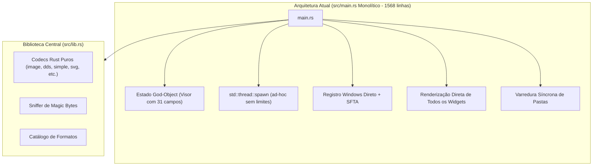
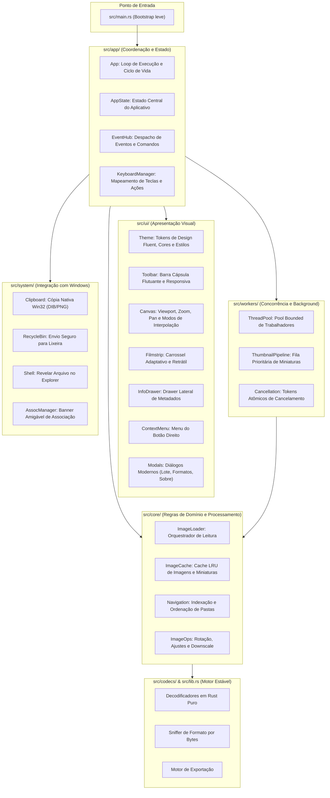
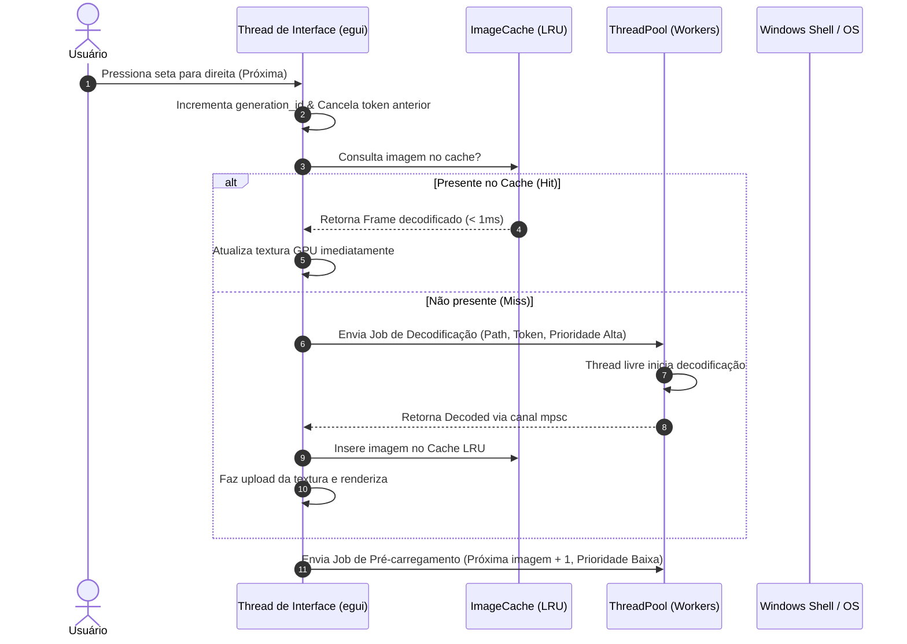

# VISOR — Arquitetura de Software e Modernização

**Status:** Fase 2 Implementada e Validada  
**Autor:** Engenharia de Sistemas & Arquitetura Rust  
**Data da Implementação:** 06/11/2026

---

## 1. Visão Arquitetural Atual vs. Alvo

### 1.1 Estado Atual (Monólito em `main.rs`)

Atualmente, o projeto possui uma separação nítida na biblioteca (`visor::*`), mas a camada executável (`src/main.rs`) sofre de acoplamento excessivo:

**Problemas da Estrutura Atual:**
* Violação do Princípio de Responsabilidade Única (SRP): a lógica de desenho de botões divide o mesmo arquivo com chamadas de processo PowerShell e matemática de vetores.
* Inexistência de testes automatizados para a interface e para a lógica de estado do aplicativo.
* Impossibilidade de reaproveitar subsistemas (ex: copiar imagem para clipboard ou enviar para lixeira) de forma isolada.

---

### 1.2 Arquitetura Alvo (Modular, Desacoplada e Orientada a Componentes)

A nova arquitetura distribui as responsabilidades em cinco domínios funcionais estritamente separados:

---

## 2. Divisão Modular e Responsabilidades

### 2.1 Módulo `src/app/` (Ciclo de Vida e Estado)
* **`app/state.rs`:** Define `AppState` e sub-estados:
  * `ViewState`: escala de zoom atual, offset de pan, modo de ajuste (`Fit`, `Actual`, `Free`), modo de interpolação (`Auto`, `Linear`, `Nearest`).
  * `FolderState`: lista indexada de caminhos, posição atual, filtros e ordenação natural de arquivos.
  * `UIState`: visibilidade do filmstrip, visibilidade do drawer de info, janela modal ativa, toasts e avisos temporários.
* **`app/events.rs`:** Enum `AppCommand` que desacopla a emissão de comandos de sua execução (ex: `Command::Navigate(Next)`, `Command::CopyImage`, `Command::DeleteCurrent`, `Command::ToggleFilmstrip`).
* **`app/shortcuts.rs`:** Mapeamento declarativo de teclas para `AppCommand`, eliminando as 80 linhas de condicionais `if key_pressed` emaranhadas.

### 2.2 Módulo `src/ui/` (Apresentação Visual e Componentes)
* **`ui/theme.rs`:** Definição centralizada dos tokens visuais:
  * Paleta Dark Mode refinada inspirada na linguagem Fluent do Windows 11 (`SurfaceBackground`, `FloatingPanelBackground`, `BorderSubtle`, `AccentBlue`, `TextPrimary`, `TextSecondary`).
  * Raios de curvatura (`corner_radius`), sombras sutis, paddings padronizados.
* **`ui/toolbar.rs`:** A nova **Toolbar Flutuante em Cápsula**:
  * Renderizada como uma superfície flutuante translúcida com cantos arredondados sobre a imagem.
  * Ocupa zero espaço vertical fixo quando em modo imersivo.
  * Agrupa botões por função: Navegação (`◀`, `▶`), Zoom (`Ajustar`, `100%`, `Zoom Slider`), Ações (`Girar`, `Copiar`, `Info`) e Menu de Opções (`⋯`).
  * Responsiva: reduz o tamanho dos botões ou colapsa em submenus caso a janela seja redimensionada para menos de 600px.
* **`ui/canvas.rs`:** Viewport de desenho da imagem:
  * Gerencia o shader/textura egui com suporte a comutação de `TextureOptions::NEAREST` e `TextureOptions::LINEAR`.
  * Renderiza o fundo transparente em 4 opções configuráveis: Xadrez Escuro (padrão), Xadrez Claro, Preto Puro e Branco Puro.
* **`ui/filmstrip.rs`:** Carrossel inferior retrátil (`T`):
  * Calcula miniaturas dinamicamente conforme a largura visível da janela.
  * Animação suave de recolhimento para liberar 100% da área para a imagem principal.
* **`ui/info_panel.rs`:** Drawer lateral moderno:
  * Desliza suavemente sobre a imagem sem forçar o recálculo do tamanho do canvas.
  * Organiza metadados em blocos lógicos: Informações do Arquivo, Detalhes Técnicos da Imagem, Dados da Câmera (ISO, Abertura, Exposição, Lente) e Perfil de Cor.
  * Botão de um clique para "Copiar todos os dados".
* **`ui/context_menu.rs`:** Menu acionado pelo botão direito na imagem com atalhos rápidos.

### 2.3 Módulo `src/core/` (Lógica de Domínio)
* **`core/image_cache.rs`:**
  * Implementação de cache LRU (*Least Recently Used*) com capacidade configurável em megabytes (default: 128 MB).
  * Mantém as imagens adjacentes (anterior e posterior) pré-decodificadas para transição instantânea de quadros.
* **`core/navigation.rs`:**
  * Ordenação alfanumérica natural compatível com o Windows Explorer (`foto1.jpg`, `foto2.jpg`, `foto10.jpg`).
  * Monitoramento inteligente de pasta para refletir arquivos adicionados ou excluídos.
* **`core/image_operations.rs`:**
  * Rotações ortogonais sem perda (`90°`, `180°`, `270°`) e espelhamento horizontal/vertical.

### 2.4 Módulo `src/workers/` (Concorrência e Paralelismo)
* **`workers/thread_pool.rs`:**
  * Pool de threads com limite máximo configurável (default: `num_cpus` limitado entre 2 e 8 threads).
  * Elimina a criação descontrolada de threads do sistema operacional.
* **`workers/cancellation.rs`:**
  * `CancellationToken` atômico que permite à thread de UI sinalizar interrupção imediata quando o usuário salta de imagem rapidamente.

### 2.5 Módulo `src/system/` (Integração com Windows)
* **`system/clipboard.rs`:**
  * Converte a imagem decodificada em bitmap nativo (`CF_DIBV5` ou canal PNG) e insere no clipboard do Windows com canal alfa preservado.
* **`system/recycle_bin.rs`:**
  * Executa a exclusão de arquivos direcionando-os para a Lixeira do Windows através das APIs seguras da Win32 (`SHFileOperationW` com `FOF_ALLOWUNDO`), prevenindo perda acidental de dados.
* **`system/shell.rs`:**
  * Abertura do arquivo ou pasta no Windows Explorer (`explorer.exe /select,"caminho"`).
* **`system/assoc_banner.rs`:**
  * Substitui o popup invasivo de configurações por um banner de interface elegante e não-intrusivo.

---

## 3. Modelo de Concorrência e Fluxo de Dados

---

## 4. Estratégia de Transição e Preservação

Para assegurar o cumprimento rigoroso dos princípios do projeto:
1. **Zero Alteração em `src/lib.rs` e Decodificadores:** Todos os módulos de codec (`dds.rs`, `simple.rs`, `raster.rs`, `sniff.rs`, `catalog.rs`, etc.) permanecerão intactos, preservando os 13 testes aprovados.
2. **Refatoração Incremental de `src/main.rs`:** A quebra do monólito será executada módulo por módulo, garantindo que o executável compile com `cargo check` e execute a cada passo intermediário.
3. **Compatibilidade Binária Estrita:** O instalador Inno Setup (`installer/visor.iss`) e o script de ícone (`build.rs`) continuarão funcionando perfeitamente com a nova estrutura.
