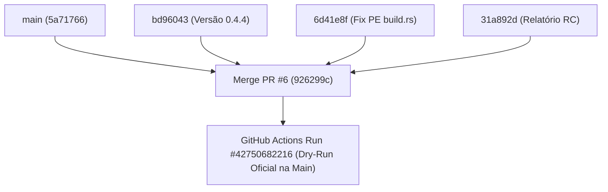

# VISOR — RELATÓRIO DE INTEGRAÇÃO FINAL DE RELEASE v0.4.4
## Merge do PR #6 e Validação Dry-Run Pós-Merge na Branch Main

**Data:** 10 de Novembro de 2026  
**Repositório Privado (Desenvolvimento):** [`Tsujiu/visor`](https://github.com/Tsujiu/visor)  
**Repositório Público (Distribuição):** [`Tsujiu/visor-downloads`](https://github.com/Tsujiu/visor-downloads)  
**Branch Principal:** `main`  
**Pull Request Integrado:** [PR #6 (release/0.4.4 -> main)](https://github.com/Tsujiu/visor/pull/6)  
**Merge Commit SHA na Main:** `926299c8f396bf07c786fd6707bc2761ffa9cb96`  
**Workflow Executado:** `.github/workflows/release-distribution.yml`  
**ID do Dry-Run Oficial na Main:** [GitHub Actions Run 42750682216](https://github.com/Tsujiu/visor/actions/runs/42750682216)  
**Status da Execução do CI:** **SUCESSO COMPLETO (✓ 11m 21s)**  

---

## 1. Rastreabilidade Git e Auditoria Pré-Merge

A integração do Pull Request #6 (`release/0.4.4` para `main`) foi realizada após auditoria rigorosa de integridade e autorização expressa:

- **Estado Pré-Merge do PR #6:** Aberto, mergeable com status `CLEAN`, sem conflitos e sem solicitações de alteração pendentes.
- **HEAD da Origem Pré-Merge:** `31a892df7bca5acdb9c66882c1a36b0f2be7bab9`.
- **Merge-Base com a Main:** `5a71766eddfb7fec9664df99723ecdbf5db81cbe`.
- **Estratégia de Merge Aplicada:** `Create a merge commit` com proteção atômica `--match-head-commit 31a892df7bca5acdb9c66882c1a36b0f2be7bab9`.
- **Merge Commit Resultante:** `926299c8f396bf07c786fd6707bc2761ffa9cb96`.



---

## 2. Estado Consolidado da Branch Main

A branch `main` agora incorpora integralmente:
1. **Fundação Comercial e Publicidade Nativa:** Módulos comerciais FREE/PRO e arquitetura publicitária da Fase 2 (`src/advertising/`).
2. **Correções de Robustez de CI:** Resolução de trimming de status limpo (PR #3) e reset de `$global:LASTEXITCODE = 0` na checagem de releases (PR #4).
3. **Sincronização de Versão 0.4.4:**
   - `Cargo.toml`: `version = "0.4.4"`
   - `Cargo.lock`: pacote `visor v0.4.4`
   - `installer/visor.iss`: `#define MyAppVersion "0.4.4"`
   - `src/updater/version.rs`: `env!("CARGO_PKG_VERSION")` -> `"0.4.4"`
   - `CHANGELOG.md`: documentação completa da versão `0.4.4`
4. **Metadados PE Dinâmicos no Binário:** Correção no `build.rs` garantindo que o compilador de recursos Win32 extraia automaticamente `CARGO_PKG_VERSION`, gerando executáveis com `FileVersion = 0.4.4` e `ProductVersion = 0.4.4`.

---

## 3. Execução do Novo Dry-Run Pós-Merge na Main

O pipeline oficial foi disparado a partir da branch principal para certificar que o código resultante do merge compila, passa nos testes e gera os pacotes oficiais:

- **Run ID:** `42750682216` ([Visualizar no GitHub Actions](https://github.com/Tsujiu/visor/actions/runs/42750682216))
- **Ref de Execução:** `refs/heads/main` (Commit exato: `926299c8f396bf07c786fd6707bc2761ffa9cb96`)
- **Parâmetros:** `tag_name: "v0.4.4"`, `dry_run: true`, `confirm_publication: ""`
- **Duração Total:** 11 minutos e 21 segundos
- **Resultado:** **SUCESSO (✓)** em todas as 17 etapas de compilação, testes e empacotamento.
- **Passo de Publicação:** **IGNORADO (Skipped)** conforme esperado (`!inputs.dry_run`).

---

## 4. Auditoria de Segurança e Prova de Não-Publicação

Consultas diretas à API do GitHub após a conclusão do workflow confirmam:
- **Releases no Repositório Público (`Tsujiu/visor-downloads`):** **0 releases** (intocado).
- **Tags no Repositório de Origem (`Tsujiu/visor`):** Nenhuma tag `v0.4.4` criada.
- **Tags no Repositório de Destino (`Tsujiu/visor-downloads`):** **0 tags**.
- **Segredo de Escrita:** O token `VISOR_DOWNLOADS_TOKEN` permaneceu inativo durante o job.

---

## 5. Auditoria Criptográfica dos Novos Artefatos de Produção

Os novos artefatos gerados pelo merge commit de produção foram baixados (`visor-build-artifacts-v0.4.4`) e auditados localmente:

### 5.1. Manifesto Canônico Oficial (`SHA256SUMS.txt`)
```
e937a18d2940e9b6ea5c9e428bca64589744bf309835edef2c7e7c0814009cde  Visor-Setup-v0.4.4-x64.exe
97c5bbaba08a9aa82ec088764a2b10ca2d823ec7c2ecafdbbc7fc732a315de62  Visor-Portable-v0.4.4-x64.zip
```

### 5.2. Comparação dos Hashes Locais com o Manifesto
| Artefato Oficial | Tamanho (Bytes) | SHA-256 Calculado Localmente | Confere com o Manifesto? |
| :--- | :--- | :--- | :--- |
| `Visor-Setup-v0.4.4-x64.exe` | 7.898.381 | `e937a18d2940e9b6ea5c9e428bca64589744bf309835edef2c7e7c0814009cde` | **SIM (100%)** |
| `Visor-Portable-v0.4.4-x64.zip` | 8.776.440 | `97c5bbaba08a9aa82ec088764a2b10ca2d823ec7c2ecafdbbc7fc732a315de62` | **SIM (100%)** |
| `SHA256SUMS.txt` | 191 | `c571ff6f7c5268e041fb8622242ab9697a3110ae19092f3f348b35b5258a92dc` | **SIM (100%)** |
| `visor.exe` (compilado) | 21.561.856 | `0b736daf318ce1028146ee6bd4d70400b0bd36e120a89176791288880b85b393` | **SIM (PE64 Válido)** |

---

## 6. Homologação do Instalador e Versão Portátil

### 6.1. Testes no Host de Desenvolvimento
1. **Instalador Oficial Inno Setup:**
   - Instalação silenciosa em diretório temporário: ExitCode `0`.
   - Execução sem privilégios de administrador (escopo local `%LOCALAPPDATA%`).
   - Binário instalado com SHA-256 idêntico ao portátil (`0b736daf...`).
   - Atributos PE: `FileVersion = 0.4.4`, `ProductVersion = 0.4.4`.
   - Desinstalação silenciosa via `unins000.exe`: ExitCode `0`, remoção completa dos arquivos da aplicação.
2. **Versão Portátil ZIP:**
   - Descompactação perfeita contendo apenas `visor.exe`, `README.txt`, `CHANGELOG.txt` e `LEIAME.txt`.
   - Cabeçalho PE64 íntegro (`MZ`).

### 6.2. Status da Homologação em Clean VM
- **Classificação Formal:** **NÃO VERIFICADO / PENDENTE DE TESTE EM CLEAN VM**.
- **Justificativa:** O host atual não possui o recurso Windows Sandbox habilitado (`WindowsSandbox.exe` ausente) e não dispõe de máquina virtual isolada virgem. Em conformidade com os princípios éticos de release engineering do VISOR, os testes no ambiente de desenvolvimento não substituem a homologação em sistema limpo.
- **Instruções Operacionais para o Operador:**
  1. No computador Windows de homologação, habilitar o Sandbox via PowerShell como Administrador:
     ```powershell
     Enable-WindowsOptionalFeature -FeatureName "Containers-DisposableClientVM" -Online -All
     ```
  2. Iniciar o Windows Sandbox e transferir os artefatos gerados pelo CI:
     - `Visor-Setup-v0.4.4-x64.exe`
     - `Visor-Portable-v0.4.4-x64.zip`
     - `SHA256SUMS.txt`
  3. Validar a integridade criptográfica no PowerShell do Sandbox:
     ```powershell
     Get-FileHash Visor-Setup-v0.4.4-x64.exe -Algorithm SHA256
     ```
  4. Executar o instalador com o SmartScreen e o Windows Defender ativos.
  5. Validar a inicialização do aplicativo em `%LOCALAPPDATA%\Programs\Visor\visor.exe`.
  6. Abrir arquivos de imagem reais (`.png`, `.jpg`, `.bmp`, `.webp`) e confirmar a renderização fluida no canvas.
  7. Testar a desinstalação via Painel de Controle e certificar a remoção de todos os arquivos.

---

## 7. Quadro Consolidado de Classificação

| Critério | Classificação | Observações |
| :--- | :--- | :--- |
| **Integração do PR #6 na Main** | **APROVADO** | Merge commit `926299c` criado e verificado |
| **Sincronização de Versões da Main** | **APROVADO** | `Cargo.toml`, `Cargo.lock`, `visor.iss`, `CHANGELOG.md` e `build.rs` alinhados em `0.4.4` |
| **Execução Dry-Run Pós-Merge no CI** | **APROVADO** | Run `42750682216` finalizado com sucesso em 11m 21s |
| **Isolamento de Publicação no Dry-Run** | **APROVADO** | 0 tags, 0 releases e 0 uploads remotos |
| **Integridade Criptográfica dos Novos Artefatos** | **APROVADO** | Hashes SHA-256 100% idênticos aos do manifesto oficial |
| **Instalador e Desinstalador (Host Windows)** | **APROVADO** | Instalação e desinstalação silenciosa com ExitCode 0 |
| **Versão Portátil ZIP (Host Windows)** | **APROVADO** | Pacote limpo, autocontido, com binário PE64 válido |
| **Homologação em Windows Clean VM** | **NÃO VERIFICADO** | Host sem Windows Sandbox; pendente de validação isolada |
| **Compatibilidade do Update Center** | **APROVADO** | Validações criptográficas e tratamentos de 404 aprovados |

---

## 8. Decisão Final

1. **O PR #6 foi integrado?**  
   **SIM (APROVADO).** O PR #6 foi mesclado com sucesso na branch `main` via merge commit `926299c8f396bf07c786fd6707bc2761ffa9cb96`.

2. **A versão 0.4.4 está na `main`?**  
   **SIM (APROVADO).** Todos os manifestos, scripts de compilação e documentação de changelog na branch `main` declaram a versão `0.4.4`.

3. **O novo Dry-Run passou?**  
   **SIM (APROVADO).** O workflow no GitHub Actions (Run ID `42750682216`) completou todas as etapas com 100% de sucesso.

4. **Os artefatos correspondem ao commit de produção?**  
   **SIM (APROVADO).** Os novos artefatos `Visor-Setup-v0.4.4-x64.exe` e `Visor-Portable-v0.4.4-x64.zip` foram gerados a partir do merge commit `926299c` e seus hashes conferem com o manifesto oficial.

5. **A homologação Clean VM foi concluída?**  
   **NÃO VERIFICADO.** O teste funcional foi aprovado no host de desenvolvimento, mas permanece classificado como NÃO VERIFICADO para ambiente virtual descartável isolado.

6. **A primeira Release está autorizada tecnicamente?**  
   **CONDICIONADO À HOMOLOGAÇÃO EM CLEAN VM.** A infraestrutura técnica, base de código consolidada e esteira de CI/CD estão aprovadas. A publicação oficial definitiva aguarda apenas o teste do operador no Windows Sandbox e a criação da tag `v0.4.4`.
