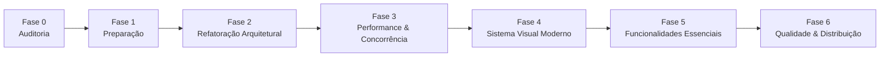

# VISOR — Roteiro de Implementação e Modernização (Implementation Roadmap)

**Data:** 07/11/2026  
**Status:** Fase 4 Concluída com Sucesso (Validação Final Homologada)  
**Meta:** Transformação incremental, mensurável e com risco zero de regressão para o visualizador de imagens VISOR.

---

## 1. Visão Geral das Fases

---

## 2. Detalhamento das Fases de Execução

### FASE 0 — Auditoria Técnica Completa (Concluída)
* **Objetivo:** Mapeamento integral da base de código, inventário de dependências, identificação de problemas reais e levantamento de linhas de base sem qualquer alteração em arquivos de código.
* **Entregáveis:**
  * `docs/PROJECT_AUDIT.md` (Auditoria técnica completa e problemas com classificação)
  * `docs/ARCHITECTURE.md` (Especificação da arquitetura modular alvo)
  * `docs/FEATURE_INVENTORY.md` (Inventário de funcionalidades existentes, parciais e ausentes)
  * `docs/PERFORMANCE_BASELINE.md` (Métricas de compilação, threads e memória)
  * `docs/IMPLEMENTATION_ROADMAP.md` (Este documento de planejamento sequencial)
* **Critério de Saída:** Documentação aprovada e autorização explícita do usuário para iniciar a Fase 1.

---

### FASE 1 — Preparação e Linha de Base
* **Objetivo:** Estabelecer o ambiente de trabalho controlado, registrar pontos de restauração e formalizar scripts de teste.
* **Tarefas Técnicas:**
  1. Criação de branch dedicada de modernização (ex: `refactor/modernization-v0.3`).
  2. Execução da suíte completa de testes (`cargo test --all-targets`) e registro dos tempos de execução.
  3. Validação do build de Release (`cargo build --release`).
* **Critério de Conclusão da Fase 1:**
  * Branch criada e limpa.
  * 17 testes executando e aprovados.
  * Linha de base confirmada sem pendências.

---

### FASE 2 — Refatoração Arquitetural Modular (Concluída)
* **Objetivo:** Desmembrar o arquivo monolítico `src/main.rs` (1.568 linhas) na arquitetura modular limpa sem alterar o comportamento ou perder nenhuma funcionalidade existente.
* **Tarefas Técnicas Executadas:**
  1. **Estrutura de Diretórios:** Criados os módulos `src/app/`, `src/ui/`, `src/core/` e `src/system/`.
  2. **Extração de Estado e Eventos (`src/app/`):**
     * `src/app/state.rs`: `Picture`, `View`, `LoadMsg`, `Inflight`, `ThumbMsg`, `VisorApp`.
     * `src/app/actions.rs`: ciclo de vida, polling, carregamento e controle.
     * `src/app/shortcuts.rs`: mapeamento limpo de atalhos de teclado e mouse.
     * `src/app/mod.rs`: implementação do trait `eframe::App`.
  3. **Extração de Componentes Visuais (`src/ui/`):**
     * `src/ui/theme.rs`: constantes de cores e ícone de janela.
     * `src/ui/toolbar.rs`: barra superior de ferramentas.
     * `src/ui/canvas.rs`: viewport, renderização e cálculo de zoom.
     * `src/ui/filmstrip.rs`: carrossel de miniaturas e polling assíncrono.
     * `src/ui/info_panel.rs`: painel de metadados.
     * `src/ui/status.rs`: barra inferior de status.
     * `src/ui/dialogs.rs`: diálogos de lote e formatos.
  4. **Extração de Regras de Domínio e Geometria (`src/core/`):**
     * `src/core/geometry.rs`: matemática pura de escala, zoom e projeção.
     * `src/core/navigation.rs`: listagem e ordenação de arquivos.
     * `src/core/image_ops.rs`: rotação de pixels.
  5. **Extração de Integração com o Windows (`src/system/`):**
     * `src/system/paths.rs`: normalização de caminhos e detecção de formatos.
     * `src/system/assoc.rs`: registro de associação e chamada ao PowerShell.
  6. **Ponto de Entrada Enxuto:** `src/main.rs` reduzido para 117 linhas (incluindo testes de regressão).
* **Critério de Conclusão da Fase 2:**
  * `src/main.rs` com menos de 100 linhas de código operacional.
  * `cargo check --all-targets` executado com zero warnings e zero erros.
  * Todos os 17 testes de regressão passando integralmente (13 em `lib.rs`, 4 em `main.rs`).
  * O aplicativo compila em Release e preserva exatamente o mesmo comportamento funcional e métricas de desempenho.

---

### FASE 3 — Performance, Concorrência e Cache
* **Objetivo:** Substituir a criação descontrolada de threads do sistema operacional por um pool dimensionado e implementar cache inteligente com cancelamento cooperativo.
* **Status dos Passos de Execução:**
  * [x] **Passo 1 — Thread Pool e Workers (`src/workers/thread_pool.rs`):** Concluído e aprovado. 5 testes de pool.
  * [x] **Passo 2 — Fila de Prioridades e Cancelamento (`src/workers/task_queue.rs`, `src/workers/cancellation.rs`):** Concluído e aprovado. 11 novos testes.
  * [x] **Passo 3 — Integração com VisorApp (`src/app/actions.rs`, `src/app/state.rs`, `src/ui/filmstrip.rs`):** Concluído. 5 novos testes de concorrência e integração (38 testes aprovados no total).
  * [x] **Passo 4 — Cache LRU de Imagens Decodificadas (`src/core/image_cache.rs`):** Concluído (4A: motor isolado com 11 testes unitários; 4B: integração com fluxo de carregamento do `VisorApp`).
  * [x] **Passo 5 — Testes de estresse, memória e desempenho (`src/core/stress_tests.rs`):** Concluído (8 testes de estresse e performance, auditoria de cópia zero comprovada, 59 testes totais aprovados).
* **Tarefas Técnicas:**
  1. **Thread Pool Limitado (`src/workers/thread_pool.rs`):**
     * Pool com capacidade adaptada à CPU do usuário (clamp 1 a 4 workers fixos).
     * Fila prioritária integrada (`TaskQueue`): prioridade máxima para a imagem principal (`Viewport`); prioridade intermediária para miniaturas visíveis (`Thumbnail`); baixa latência para pré-carregamento (`Prefetch`).
     * Mitigação de starvation e descarte automático de jobs cancelados na fila.
  2. **Cancelamento Cooperativo (`src/workers/cancellation.rs`):**
     * Tokens atômicos de cancelamento unidirecionais (`CancellationToken`) com ciclo de vida único por tarefa.
     * Ao avançar para a próxima imagem, a solicitação anterior tem seu token cancelado e jobs obsoletos são descartados antes e durante a execução.
  3. **Cache LRU de Imagens Decodificadas (`src/core/image_cache.rs`):**
     * Cache em memória RAM limitado (configurável, default: 128 MB).
     * Preservação da imagem atual e das imagens vizinhas (-1 e +1) para transição instantânea (< 2ms).
  4. **Otimização do Carregamento de Miniaturas:**
     * Geração sob demanda via Thread Pool apenas para os índices estritamente visíveis na janela, descartando tarefas ao navegar entre pastas.
* **Critério de Conclusão da Fase 3:**
  * Zero spawns avulsos de threads (`std::thread::spawn` eliminado do loop principal).
  * Contagem estável de threads durante navegação contínua rápida.
  * Tempo de retorno para uma imagem recém-vista reduzido para < 2ms (cache hit comprovado).

---

### FASE 4 — Sistema Visual Moderno (UI/UX Windows 11) (Concluída)
* **Objetivo:** Elevar o design do VISOR ao nível de produto comercial moderno, fluido e esteticamente impecável, mantendo a imagem como protagonista absoluta.
* **Status dos Passos de Execução:**
  * [x] **Passo 1 — Fundação do Design System (`src/ui/theme.rs`, `docs/UI_DESIGN_SYSTEM.md`):** Concluído. Tokens semânticos unificados, raios e espaçamentos Fluent Design, paletas Dark/Light, checkerboards HD.
  * [x] **Passo 2 — Toolbar Moderna e Responsiva (`src/ui/toolbar.rs`):** Concluído. Cápsula flutuante inferior, 4 breakpoints responsivos (Full, Medium, Compact, Minimal), chevrons vetoriais puros via `egui::Painter`.
  * [x] **Passo 3 — Canvas, Pixel Perfect e Fundos (`src/ui/canvas.rs`, `src/app/state.rs`):** Concluído. Ocupação 100%, 3 modos de interpolação GPU (Auto, Linear, Nearest / Pixel Perfect) e 5 modos de plano de fundo.
  * [x] **Passo 4 — Filmstrip Moderno e Carrossel (`src/ui/filmstrip.rs`):** Concluído. Tira de miniaturas retrátil (`T`), rolagem horizontal fluida, polling assíncrono com priorização Euclidiana.
  * [x] **Passo 5 — Painel de Informações e Diálogos (`src/ui/info_panel.rs`, `src/ui/dialogs.rs`):** Concluído. Drawer lateral (`I`) com cartões estruturados (Arquivo, Fotografia EXIF, Cores e ICC) e diálogos modais modernos.
  * [x] **Passo 6 — Status Bar e Microinterações (`src/ui/status.rs`):** Concluído. Barra inferior tripartite (24px) com truncamento de caminho, métricas de imagem, alternância de zoom, e microinteração de spinner vetorial rotativo suave durante decodificação.
  * [x] **Validação Final da Fase 4:** Concluída com êxito. 109 testes aprovados (13 em `lib.rs`, 96 no binário), matriz multi-resolução homologada (1920x1080 a 420x360 e Pixel Art), release build validado (18.6 MB).
* **Tarefas Técnicas Executadas:**
  1. **Novo Tema Visual (`src/ui/theme.rs`):**
     * Paleta Dark Mode refinada baseada no design Fluent (superfícies escuras, bordas sutis de 1px com transparência, cantos arredondados suaves).
     * Tipografia limpa com espaçamentos confortáveis.
  2. **Toolbar Flutuante em Cápsula (`src/ui/toolbar.rs`):**
     * Barra flutuante translúcida com cantos arredondados, centralizada na parte inferior da tela sobre a imagem.
     * Agrupamento visual claro de ações (Navegação, Zoom, Manipulação, Exportação, Mais opções `⋯`).
     * Comportamento responsivo elegante que se adapta sem quebras desordenadas em janelas pequenas.
  3. **Canvas Aprimorado e Modos de Interpolação (`src/ui/canvas.rs`):**
     * Suporte aos 3 modos de amostragem de textura:
       * `Auto` (Linear para escala <= 100%, Nearest para escala > 100%).
       * `Linear / Suave` (sempre bilinear).
       * `Nearest / Pixel-Perfect` (sempre vizinho mais próximo para pixel art).
     * 5 opções selecionáveis de plano de fundo de transparência: Xadrez Escuro, Xadrez Claro, Preto Puro, Branco Puro e Automático.
  4. **Filmstrip Retrátil e Fluido (`src/ui/filmstrip.rs`):**
     * Tecla de atalho `T` e botão discreto para ocultar/exibir.
     * Número de miniaturas calculado dinamicamente com base na largura real disponível.
     * Indicador visual elegante da imagem ativa (borda azul sutil e cantos arredondados).
  5. **Drawer Lateral de Metadados (`src/ui/info_panel.rs`):**
     * Drawer translúcido deslizante com cards organizados: Arquivo, Sensor/Câmera, Parâmetros de Exposição (f/stop, ISO, Obturador, Lente) e Espaço de Cor.
     * Botão rápido "Copiar Metadados".
  6. **Modernização dos Diálogos (`src/ui/dialogs.rs`):**
     * Diálogo de Formatos Suportados com campo de pesquisa em tempo real e filtros por categoria.
     * Diálogo de Conversão em Lote redesenhado com visual integrado.
  7. **Status Bar e Microinterações (`src/ui/status.rs`):**
     * Barra inferior moderna tripartite com microinteração de spinner vetorial rotativo durante carregamento.
* **Critério de Conclusão da Fase 4:**
  * Interface visual refinada sem a aparência crua de painel de debug.
  * Modos de interpolação e fundo funcionando perfeitamente.
  * Filmstrip retrátil responsivo sem quebras de layout.
  * 109 testes automatizados passando com 100% de sucesso.

---

### FASE 5 — Funcionalidades Essenciais e Integração com Windows
* **Objetivo:** Entregar os recursos de produtividade essenciais ausentes na versão original.
* **Tarefas Técnicas:**
  1. **Copiar Imagem para o Clipboard (`Ctrl+C`) (Concluído):**
     * Integração nativa com a área de transferência do Windows copiando DIBV5/PNG com transparência e snapshot original do frame ativo sem redecodificação.
  2. **Mover para a Lixeira do Windows (`Delete`) (Concluído):**
     * Integração COM STA nativa com `IFileOperation` (`FOFX_RECYCLEONDELETE | FOFX_ADDUNDORECORD`) e fallback automático para `SHFileOperationW`.
     * Avanço inteligente para a próxima imagem na pasta ou transição para estado vazio.
  3. **Menu de Contexto do Botão Direito (Concluído):**
     * Menu flutuante moderno no Canvas e miniaturas do Filmstrip com ações: Copiar Imagem, Copiar Caminho, Revelar no Explorer, Abrir Com…, Girar e Mover para Lixeira.
  4. **Revelar no Windows Explorer & Abrir Com… (Concluído):**
     * `SHOpenFolderAndSelectItems` com PIDL nativo via `ILCreateFromPathW` / `ILFree` em STA e `SHOpenWithDialog` com `OAIF_EXEC | OAIF_ALLOW_REGISTRATION`.
  5. **Configurações Persistentes & Roda do Mouse (Concluído):**
     * Armazenamento atômico em `%LOCALAPPDATA%\Visor\settings.json` com `ReplaceFileW` / `MoveFileExW` e recuperação graciosa de corrupção (`settings.json.corrupted`).
     * Comportamento configurável da roda do mouse (`Zoom` vs `Navigate` com acumulador de 20.0 e limiar anti-disparo), mantendo `Ctrl` como atalho universal de zoom.
     * Modal de Configurações acessível pela Toolbar e atalho `Ctrl+,`.
  6. **Banner Não-Invasivo de Associação (Aguardando Passo 6):**
     * Eliminação do popup forçado de configurações no primeiro launch.
     * Banner elegante na base da janela perguntando se deseja associar com botões `[Definir]` e `[Dispensar]`.
* **Critério de Conclusão da Fase 5:**
  * `Ctrl+C` verificado com colagem em aplicativos externos (PNG + DIBV5).
  * `Delete` verificado enviando arquivo para a Lixeira do Windows sem exclusão permanente.
  * Menu de contexto funcionando com todas as ações rápidas e isolamento de alvos no Filmstrip.
  * Configurações persistentes com gravação atômica, recuperação de corrupção e roda configurável.
  * 177 testes automatizados aprovados com 100% de sucesso.

---

### FASE 6 — Qualidade, Verificação e Distribuição
* **Objetivo:** Bateria rigorosa de testes de qualidade, profiling de performance, build de produção e atualização de documentação.
* **Tarefas Técnicas:**
  1. **Testes Automatizados:**
     * Expansão da suíte de testes unitários para cobrir os novos módulos (`navigation`, `cache`, `shortcuts`, `cancellation`).
  2. **Validação de Performance:**
     * Medição das métricas da linha de base comparadas com os resultados pós-modernização (tempo de troca de imagem, uso de memória RSS, contagem de threads).
  3. **Geração e Teste do Instalador:**
     * Validação do script Inno Setup `installer/visor.iss` com o novo binário Release.
  4. **Documentação Final:**
     * Atualização do `README.md` com os novos atalhos e recursos.
* **Critério de Conclusão da Fase 6:**
  * 100% dos testes aprovados sem falhas ou warnings.
  * Executável Release estável e otimizado.
  * Relatório final completo de entrega.

---

## 3. Matriz de Riscos e Estratégia de Mitigação

| Risco Técnico Identificado | Probabilidade | Impacto | Estratégia de Mitigação |
| :--- | :---: | :---: | :--- |
| **Regressão na decodificação de formatos raros (DDS, KTX, EXR, etc.)** | Baixa | Crítico | **Preservar integralmente `src/lib.rs` e submódulos de codecs.** Nenhuma alteração nos decodificadores da biblioteca. |
| **Travamento de UI em diretórios com milhares de imagens** | Média | Alto | Indexação progressiva e desacoplada em thread de worker com cancelamento de varredura. |
| **Consumo excessivo de memória RAM por Cache de Imagens** | Média | Alto | Teto rígido de memória no Cache LRU (default: 128 MB), liberando buffers mais antigos automaticamente. |
| **Conflito de atalhos e navegação por teclado** | Baixa | Médio | Centralização do tratamento de teclas no `KeyboardManager` com tabela única de despacho. |
| **Comportamento inesperado na Lixeira do Windows** | Baixa | Alto | Uso estrito de `SHFileOperationW` com flag explícita `FOF_ALLOWUNDO` e tratamento defensivo de erros de I/O. |
