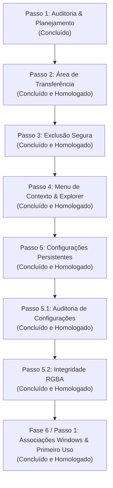

# VISOR — Plano de Implementação da Fase 5
## Integração com o Windows, Produtividade e Persistência

**Data:** 08/11/2026  
**Status:** Fase 5 Concluída e Fase 6 / Passo 1 Concluído com Sucesso — 196 testes aprovados (13 em `src/lib.rs`, 183 no executável)  
**Branch de Trabalho:** `feature/visor-modernization`  
**Linha de Base de Testes Atualizada:** 196 testes aprovados (13 em `src/lib.rs`, 183 no executável)

---

### 1. Princípios de Engenharia e Salvaguardas

1. **Risco Zero de Regressão:**
   - Todos os 186 testes anteriores continuam passando rigorosamente (total expandido para 196 testes).
   - O arquivo `src/lib.rs` e todos os 16 módulos de codecs permanecem estritamente bloqueados contra alteração.
2. **Separação Rigorosa de Camadas:**
   - Chamadas Win32 / Shell / COM e Registro residem exclusivamente em `src/system/shell_sta.rs`, `src/system/trash.rs`, `src/system/explorer.rs`, `src/system/config.rs` e `src/system/assoc.rs`.
   - Componentes visuais (`src/ui/`) não chamam APIs COM ou manipulam chaves de registro diretamente; comunicam-se via métodos de despacho em `src/app/actions.rs`.
3. **Resiliência e Recuperação Graciosa:**
   - Toda operação de sistema operacional (clipboard, lixeira, configurações, associações) possui tratamento de erros defensivo com mensagens amigáveis na UI, sem causar pânico em threads.
4. **Execução Passo a Passo Autorizada:**
   - Cada passo é iniciado somente após autorização formal do usuário.

---

### 2. Ordem de Implementação Recomendada

---

### 3. Detalhamento dos Passos de Execução

#### Passo 2 — Área de Transferência Avançada (`Ctrl+C`) (Concluído)
* **Arquivos Criados:**
  - `src/system/clipboard.rs` (operações Win32 de área de transferência, codificação PNG e DIBV5 com premultiplicação e RAII).
* **Arquivos Modificados:**
  - `src/system/mod.rs` (exportar módulo de clipboard).
  - `src/app/shortcuts.rs` (capturar `Ctrl+C` quando widgets de texto não possuem foco).
  - `src/app/actions.rs` (método `app.copy_current_image()` assíncrono via `ThreadPool` e processamento no `pump()`).
  - `src/app/state.rs` (`ClipboardMsg`, `clipboard_rx`, `clipboard_token`).
  - `src/main.rs` (testes de integração automatizados).
* **Resultados e Métricas Homologadas:**
  - `Ctrl+C` extrai o frame ativo em resolução original sem redecodificação ou leitura de disco.
  - Suporte simultâneo aos formatos `"PNG"` (com canal alfa direto de 8 bits) e `CF_DIBV5` (`BITMAPV5HEADER` top-down com alfa premultiplicado).
  - 18 novos testes unitários e de integração adicionados (127 testes no total passando com 100% de sucesso).
  - Build de Release atualizado (`target/release/visor.exe`, 18.7 MB).

---

#### Passo 3 — Exclusão Segura para a Lixeira (`Delete`) (Concluído)
* **Arquivos Criados:**
  - `src/system/shell_sta.rs` (executor STA dedicado com thread de longa duração, `CoInitializeEx(COINIT_APARTMENTTHREADED | COINIT_DISABLE_OLE1DDE)`, bombeamento de mensagens `PeekMessageW`, RAII e shutdown limpo).
  - `src/system/trash.rs` (integração segura via `IFileOperation` com `FOFX_RECYCLEONDELETE` e fallback controlado para `SHFileOperationW` com `FOF_ALLOWUNDO`).
* **Arquivos Modificados:**
  - `src/system/mod.rs` (exportar módulos `shell_sta` e `trash`).
  - `src/app/state.rs` (`TrashMsg`, campos `shell_sta`, `trash_rx`, `deleting_path` no `VisorApp`).
  - `src/app/actions.rs` (método `app.delete_current_image()`, despacho assíncrono via STA, processamento no `pump()` com invalidação de cache, reajuste de índice, transição para Empty State e notificações).
  - `src/app/shortcuts.rs` (capturar tecla `Delete` pura sem modificadores e sem interferir em campos de texto; rejeição de `Shift+Delete`).
  - `src/main.rs` (testes de integração automatizados com validação real na Lixeira do Windows e restauração).
* **Resultados e Métricas Homologadas:**
  - Pressionar `Delete` move o arquivo para a Lixeira do Windows (absolutamente nenhuma exclusão permanente).
  - Suporte nativo completo a `Ctrl+Z` e restauração pelo Windows Explorer.
  - Teste de ponta a ponta validou a criação de arquivo com acentos e espaços (`foto_teste_açúcar_e_coração.png`), exclusão para a Lixeira, inspeção via Shell COM e restauração perfeita com verificação de integridade dos pixels.
  - 21 novos testes adicionados (total do projeto elevado de 127 para 148 testes, 100% aprovados sem falhas ou warnings).
  - Binário Release atualizado (`target/release/visor.exe`).

---

#### Passo 3.1 — Auditoria Complementar de Conformidade da Lixeira (Concluído)
* **Arquivos Modificados:**
  - `src/system/trash.rs` (adição de `FOFX_ADDUNDORECORD`, função `get_visor_main_window_handle()` com validação estrita de PID, verificação de `IsWindow()` e exportação de `delete_via_shfileop`).
  - `src/system/shell_sta.rs` (rejeição estrita de `RPC_E_CHANGED_MODE` impedindo execução de `IFileOperation` fora de STA).
  - `src/app/state.rs` (`pub shell_sta: Option<Arc<ShellStaExecutor>>`).
  - `src/app/actions.rs` (captura do HWND da janela do VISOR na thread UI e fallback controlado no ThreadPool caso STA esteja indisponível).
  - `src/main.rs` (testes de rejeição de `RPC_E_CHANGED_MODE`, isolamento de PID do HWND e fallback quando `shell_sta` é `None`).
* **Resultados e Métricas Homologadas:**
  - Configuração final de flags: `FOFX_RECYCLEONDELETE | FOFX_ADDUNDORECORD` (`0x20080000`).
  - Suporte completo a Undo no Windows Explorer e restauração pela Lixeira.
  - Segurança do apartamento COM validada contra `RPC_E_CHANGED_MODE`.
  - HWND com garantia de pertencer ao VISOR e verificação de ciclo de vida (`IsWindow`).
  - 3 novos testes adicionados (total de 151 testes aprovados sem falhas ou avisos).
  - Release build validado (`target/release/visor.exe`).

---

#### Passo 4 — Menu de Contexto Moderno & Revelar no Explorer (Concluído e Validado)
* **Arquivos Criados:**
  - `src/ui/context_menu.rs` (componente visual do menu flutuante Fluent Design).
  - `src/system/explorer.rs` (função de seleção nativa no Windows Explorer).
* **Arquivos Modificados:**
  - `src/system/mod.rs` (exportar explorer e `reveal_in_explorer`).
  - `src/ui/mod.rs` (exportar `context_menu` e `render_context_menu`).
  - `src/ui/canvas.rs` (associar `.context_menu()` no canvas).
  - `src/ui/filmstrip.rs` (associar `.context_menu()` em cada miniatura do filmstrip).
  - `src/app/actions.rs` (métodos `app.reveal_in_explorer()`, `app.copy_path()` e `app.delete_image_at_path()`).
* **Implementação Técnica:**
  - Método `reveal_in_explorer(path: &Path)`: invoca primariamente a API nativa do Shell do Windows (`SHOpenFolderAndSelectItems`) via PIDL (`ILCreateFromPathW` / `ILFree`), garantindo que pastas já abertas sejam reutilizadas e o item destacado sem novos processos supérfluos. Possui fallback transparente para `explorer.exe /select,"<caminho>"`.
  - Renderização do menu de contexto com identidade visual Fluent Design (`surface_flyout`, `border_subtle`, cantos `RADIUS_MD` 8px e hover com `RADIUS_SM` 5px).
  - Agrupamento funcional com separadores sutis:
    - *Ações de Área de Transferência:* Copiar Imagem (`Ctrl+C`), Copiar Caminho Completo.
    - *Manipulação:* Girar 90° à Direita (`R`), Girar 90° à Esquerda (`Shift+R`).
    - *Visualização:* Ajustar à Tela (`F`), Tamanho Real 100% (`1`), Pixel Perfect (`P`), Alternar Fundo (`B`).
    - *Informações e Sistema:* Revelar no Explorador de Arquivos, Painel de Informações (`I`).
    - *Destrutivas (Separadas):* Mover para a Lixeira (`Delete`) com destaque sutil de aviso no hover.
  - Suporte completo a 3 contextos de ativação:
    - Canvas com imagem ativa carregada.
    - Canvas vazio (Empty State: Abrir Imagem, Formatos Suportados, Conversão em Lote).
    - Miniatura do Filmstrip (ações direcionadas para o arquivo específico clicado).
* **Validação e Homologação:**
  - 7 novos testes unitários adicionados em `src/ui/context_menu.rs`.
  - 2 testes unitários adicionados em `src/system/explorer.rs`.
  - Total de 160 testes aprovados sem falhas ou avisos (13 em `lib.rs`, 147 no executável).
  - Release build validado (`target/release/visor.exe` com 18.799.104 bytes).

---

#### Passo 5 — Configurações Persistentes & Roda do Mouse (Concluído)
* **Arquivos Criados:**
  - `src/system/config.rs` (modelo `AppSettings`, serialização Serde, `MouseWheelAction`, salvamento atômico Win32 via `ReplaceFileW` e `MoveFileExW`, recuperação de corrupção com backup `.corrupted`, versionamento de schema).
  - `src/ui/settings.rs` (janela modal de Configurações integrada ao Design System Fluent, com controle da roda do mouse, interpolação, transparência, layout inicial e botão de restaurar padrões).
* **Arquivos Modificados:**
  - `Cargo.toml` / `Cargo.lock` (dependências autorizadas: `serde` com derive e `serde_json`).
  - `src/system/mod.rs` (exportar `AppSettings` e `MouseWheelAction`).
  - `src/app/state.rs` (derivação Serde para `InterpolationMode`, serialização segura de `CanvasBackground` via `[u8; 4]`, campos `settings`, `show_settings` e `wheel_nav_accumulator` no `VisorApp`, persistência na terminação em `Drop`).
  - `src/app/actions.rs` (carregamento inicial de preferências em `VisorApp::new`, métodos `save_settings` assíncrono e `restore_default_settings`).
  - `src/app/shortcuts.rs` (atalho `Ctrl+,` para abrir/fechar Configurações).
  - `src/app/mod.rs` (renderização de `render_settings_window`).
  - `src/ui/canvas.rs` (comportamento configurável da roda: `Zoom` ancorado vs `Navigate` entre imagens com acumulador de 20.0 e limiar anti-disparo acidental; tecla `Ctrl` sempre força zoom).
  - `src/ui/toolbar.rs` (item "Configurações… (Ctrl+,)" no menu Mais Opções `⋯`).
  - `src/ui/mod.rs` (exportar `render_settings_window`).
  - `src/main.rs` (teste de integração ponta a ponta `test_persistent_settings_e2e_integration`).
* **Resultados e Métricas Homologadas:**
  - Armazenamento em `%LOCALAPPDATA%\Visor\settings.json` com gravação atômica nativa Windows e tolerância total a quedas de energia.
  - Recuperação graciosa de arquivos corrompidos: backup automático para `.corrupted`, restauração de padrões e continuidade normal sem crash.
  - Suporte retrocompatível a campos desconhecidos de schemas futuros.
  - Roda do mouse no modo `Navigate`: folheia imagens por etapas limpas com reset de acumulador por inversão e saída do canvas.
  - Atalho `Ctrl` mantido como override universal para zoom contínuo sob o cursor em qualquer modo.
  - 12 novos testes adicionados (total de 177 testes passando com 100% de sucesso).
  - Build de Release atualizado (`target/release/visor.exe`).

---

#### Passo 5.1 — Auditoria Complementar de Configurações Persistentes (Concluído)
* **Arquivos Modificados:**
  - `src/system/config.rs`:
    - Adicionado suporte e campo `custom_color: [u8; 4]`.
    - Adicionada detecção e proteção contra sobrescrita de versão futura (`is_future_version` com aviso não intrusivo e bloqueio de salvamento automático).
    - Implementado `SettingsWriter` serializado com canal, coalescência de rajadas, encerramento gracioso via `shutdown_and_wait` e proteção de exclusão mútua (`SAVE_MUTEX`).
    - Adicionados testes de downgrade de schema, persistência RGBA e concorrência com coalescência.
  - `src/ui/canvas.rs`:
    - Implementada função `is_canvas_interaction_active` garantindo isolamento total da roda do mouse contra Filmstrip, Info Panel, janelas modais, toolbar e caixas de texto ativas.
    - Adicionado teste exaustivo de isolamento de mouse wheel.
  - `src/ui/settings.rs`:
    - Integrado seletor de "Cor Personalizada" com `ui.color_edit_button_srgba` no modal de configurações.
  - `src/ui/toolbar.rs`:
    - Atualizada a seleção e alteração da cor personalizada para persistir `custom_color` e salvar instantaneamente.
  - `src/app/state.rs`:
    - Ajustada desserialização de `CanvasBackground::Custom` para `Color32::from_rgba_premultiplied`, preservando 100% dos bytes RGBA sem degradação aritmética.
    - Integrado `settings_writer` com encerramento gracioso no `Drop` do aplicativo.
  - `src/app/actions.rs`:
    - Inicialização e despacho seguro via `SettingsWriter`.
  - `src/main.rs`:
    - Adicionado teste ponta a ponta `test_custom_color_e2e_persistence_and_subsequent_edits`.
* **Resultados e Métricas Homologadas:**
  - Proteção estrita de arquivos futuros: downgrades leem com segurança e bloqueiam sobrescrita destrutiva, mantendo campos desconhecidos intactos.
  - Cores personalizadas possuem persistência RGBA exata sem perdas entre reinicializações e modificações subsequentes de preferências.
  - Roda do mouse atua única e exclusivamente sobre o Canvas em primeiro plano.
  - 182 testes aprovados sem falhas ou avisos (13 em `src/lib.rs`, 169 no executável).
  - Build de Release atualizado (`target/release/visor.exe`).

---

#### Passo 6 — Associação de Arquivos Não-Invasiva & Banner Informativo
* **Arquivos a Criar:**
  - `src/ui/banner.rs` (banner elegante Fluent Design na base da janela).
* **Arquivos a Modificar:**
  - `src/system/assoc.rs` (remover chamada compulsória de `open_default_apps_settings`).
  - `src/app/mod.rs` (renderizar o banner condicionalmente quando não associado e não dispensado).
* **Implementação Técnica:**
  - Modificar `maybe_register_on_first_launch`: apenas registra as capacidades silenciosamente no Registro (`HKCU\Software\Classes`), **sem abrir a janela de configurações do Windows**.
  - O aplicativo detecta se o VISOR é o padrão para PNG (`current_png_progid`). Se não for e `config.assoc_prompt_dismissed == false`:
    - Exibe um banner translúcido discreto sobre o rodapé da interface.
    - Mensagem: *"Deseja definir o VISOR como seu visualizador de imagens padrão?"*
    - Botão primário: `[Definir como Padrão]` -> abre as configurações do Windows (`ms-settings:defaultapps`) com consentimento do usuário e registra `assoc_prompt_dismissed = true`.
    - Botão secundário: `[Agora Não]` -> fecha o banner temporariamente.
    - Botão terciário: `[Não Perguntar Novamente]` -> grava `assoc_prompt_dismissed = true` em `settings.json`.
* **Critérios de Aceitação:**
  - O primeiro lançamento do VISOR é 100% silencioso e não invade a tela do usuário com janelas do sistema operacional.
  - O usuário possui controle total e pode dispensar permanentemente o aviso com um clique.

---

#### Passo 7 — Validação Integrada da Fase 5 e Homologação
* **Escopo:**
  - Execução da suíte completa de testes unitários e de integração (`cargo test --all-targets -- --nocapture`).
  - Testes com imagens transparentes (PNG, WebP, GIF, SVG) copiadas para o clipboard e coladas em softwares externos.
  - Testes de exclusão segura na Lixeira com restauração via `Ctrl+Z` no Explorer.
  - Teste de menus de contexto no Canvas e no Filmstrip em todas as resoluções da matriz.
  - Teste de integridade do salvamento e carregamento atômico de configurações.
  - Elaboração do Relatório Final de Homologação da Fase 5 (`docs/PHASE5_FINAL_REPORT.md`).

---

### 4. Matriz de Dependências Técnicas

Nenhuma dependência externa nova precisa ser adicionada ao `Cargo.toml`. Todas as funcionalidades da Fase 5 serão construídas aproveitando a infraestrutura existente:
- Win32 API via `windows-sys = { version = "0.61", features = ["Win32_Foundation", "Win32_Graphics_GdiPlus", "Win32_UI_Shell"] }` e bindings FFI seguros em `src/system/`.
- Serialização e parsing seguro de JSON sem dependências pesadas em `src/system/config.rs`.
- Egui / Eframe 0.37 existente para menus de contexto, banners e eventos de entrada.

---

### 5. Ponto de Parada Obrigatório

A auditoria e o plano de implementação foram formalizados. **Nenhuma linha de código funcional foi alterada.**

Aguardando autorização explícita do usuário para dar início ao **Passo 2 (Área de Transferência Avançada — Ctrl+C)**.
