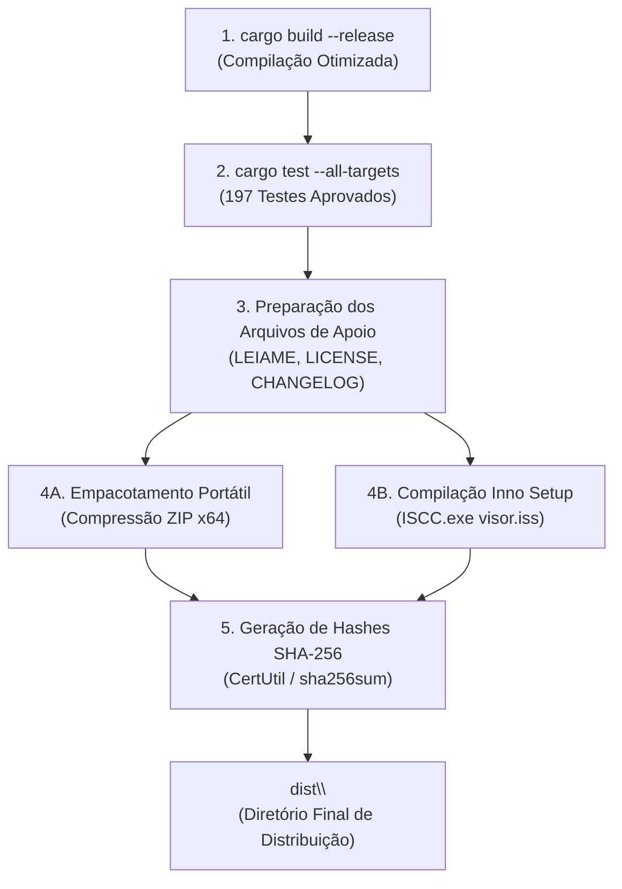

# VISOR — Plano Técnico de Release e Distribuição Pública
## Fase 6 / Passo 2: Estratégia de Publicação e Versionamento (Windows 10 e 11)

---

## 1. Visão Geral e Objetivos do Release

O objetivo deste plano é padronizar a geração, empacotamento, verificação de integridade e distribuição do VISOR para usuários finais do Windows 10 e Windows 11 (arquitetura x64).

A publicação oficial contempla duas modalidades complementares:
1. **VISOR Installer (`Visor-Setup-vX.Y.Z-x64.exe`):** Experiência de instalação integrada ao sistema operacional, criando atalhos, registrando capacidades e facilitando a escolha do VISOR como visualizador padrão.
2. **VISOR Portable (`Visor-Portable-vX.Y.Z-x64.zip`):** Pacote autônomo sem necessidade de instalação, ideal para execução a partir de pen drives, pastas de rede ou ambientes corporativos com restrições de instalação.

---

## 2. Nomenclatura Padronizada de Artefatos

Todos os arquivos distribuídos seguirão convenção uniforme com versão e arquitetura:

| Nome do Arquivo | Modalidade | Descrição |
| :--- | :--- | :--- |
| `Visor-Setup-v0.2.2-x64.exe` | Instalador | Pacote executável gerado pelo Inno Setup com compressão LZMA2. |
| `Visor-Portable-v0.2.2-x64.zip` | Portátil | Arquivo ZIP compactado contendo o executável e documentação. |
| `SHA256SUMS.txt` | Integridade | Tabela de hashes SHA-256 de todos os artefatos para verificação criptográfica. |

---

## 3. Composição Detalhada dos Pacotes

### A. Pacote Portátil (`Visor-Portable-v0.2.2-x64.zip`)

```
Visor-Portable-v0.2.2-x64/
│
├── visor.exe                 # Executável otimizado (18 MB, standalone)
├── LEIAME.txt                # Guia completo de uso, recursos e atalhos
├── README-PORTABLE.txt       # Guia rápido da distribuição portátil
└── CHANGELOG.md              # Histórico de alterações e novidades da versão
```

#### Diretrizes da Versão Portátil:
- **Zero Instalação:** Não cria entradas no registro do Windows ao ser aberto.
- **Portabilidade Total:** Pode ser executado de qualquer diretório ou mídia removível.
- **Registro Opcional:** Caso o usuário deseje, pode utilizar o banner de primeiro uso ou o comando `--registrar-padrao` para associar formatos ao seu perfil de usuário.

### B. Pacote do Instalador (`Visor-Setup-v0.2.2-x64.exe`)

```
Instalação em: %LOCALAPPDATA%\Programs\Visor\
│
├── visor.exe                 # Executável principal
├── unins000.exe              # Desinstalador oficial gerado pelo Inno Setup
├── unins000.dat              # Metadados de desinstalação
├── LEIAME.txt                # Documentação técnica e termos de uso
└── CHANGELOG.md              # Histórico de versões
```

#### Atalhos e Integração Criados pelo Instalador:
- Atalho no Menu Iniciar: `{autoprograms}\Visor.lnk`
- Atalho opcional na Área de Trabalho: `{autodesktop}\Visor.lnk`
- Registro no Windows: Executa o registro idempotente em `HKCU` como candidato no catálogo oficial.
- Entrada em "Aplicativos e Recursos" / "Painel de Controle" do Windows para desinstalação padrão.

---

## 4. Fluxo de Trabalho de Geração de Releases (Workflow)



### Etapas Operacionais:
1. **Compilação Release:**
   ```powershell
   cargo build --release --locked
   ```
2. **Validação Rigorosa de Testes:**
   ```powershell
   cargo test --all-targets -- --nocapture
   ```
3. **Criação do Diretório de Distribuição:**
   ```powershell
   New-Item -ItemType Directory -Force -Path "dist"
   ```
4. **Geração do Pacote Portátil (ZIP):**
   Agrupa `visor.exe`, `LEIAME.txt`, `README-PORTABLE.txt` e `CHANGELOG.md` utilizando compactação padrão Deflate/LZMA.
5. **Geração do Instalador (Inno Setup):**
   Invoca o compilador de linha de comando:
   ```powershell
   & "C:\Users\bruno\AppData\Local\Programs\Inno Setup 6\ISCC.exe" "installer\Visor.iss" /O"dist" /F"Visor-Setup-v0.2.2-x64"
   ```
6. **Cálculo de Checksums Criptográficos:**
   Gera `SHA256SUMS.txt` contendo os hashes de integridade para verificação pelo usuário.

---

## 5. Estratégia de Versionamento e Atualização

1. **Versionamento Semântico (SemVer):**
   `MAJOR.MINOR.PATCH` (ex: `0.2.2`).
   - `MAJOR`: Quebras de compatibilidade ou mudanças radicais de arquitetura.
   - `MINOR`: Novas funcionalidades, novos formatos suportados, melhorias de interface.
   - `PATCH`: Correções de bugs, ajustes de performance ou correções de segurança.
2. **Atualização In-Place (Sobreposição Segura):**
   - Ao executar o instalador de uma nova versão, o Inno Setup detecta a versão instalada anteriormente no mesmo diretório `{localappdata}\Programs\Visor`.
   - Os binários são atualizados sem deletar ou reiniciar a máquina.
   - O arquivo de configurações `%LOCALAPPDATA%\Visor\settings.json` é **estritamente preservado**, garantindo que o usuário mantenha todas as suas personalizações.

---

## 6. Considerações sobre Assinatura Digital e SmartScreen

1. **Cenário Atual (Sem Certificado Comercial):**
   - Softwares novos sem certificado de assinatura de código EV (Extended Validation) acionam temporariamente a mensagem "O Windows protegeu o computador" (SmartScreen) até que acumulem reputação de download na rede Microsoft.
2. **Estratégia de Transparência:**
   - Publicar hashes SHA-256 públicos no repositório oficial para conferência.
   - Fornecer instruções claras para o usuário clicar em *"Mais informações" -> "Executar assim mesmo"*.
   - Código 100% auditável e aberto, sem telemetria, anúncios ou bibliotecas opacas.
3. **Perspectiva Futura:**
   - Avaliação de certificados SignPath Foundation ou certificados de código aberto reconhecidos quando o projeto atingir distribuição em larga escala.

---

## 7. Checklist de Homologação Pré-Publicação

- [x] Binário compilado com perfil release (`lto = "thin"`, `strip = "symbols"`).
- [x] 100% dos testes unitários e de integração aprovados (197 testes).
- [x] Zero dependências externas de DLLs não nativas confirmadas via PE header dump.
- [x] Ícone da aplicação embutido em alta resolução (.rsrc).
- [x] Informações de versão e metadados sincronizados (`0.2.2.0`).
- [x] Inno Setup 6 instalado e validado localmente.
- [x] Preservação de configurações em `%LOCALAPPDATA%\Visor\settings.json` garantida por testes.
- [x] Especificação do instalador e script `.iss` documentados e prontos para implementação.
